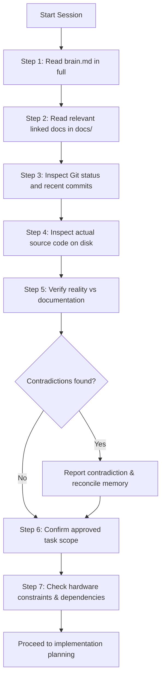

# AGENTS.md — Mandatory AI Coding Agent Operating Protocol & Project Instructions

> **Project Identity:** Original 3D Browser Open-World Game (Codename: *Vice-City* / Web Open World)  
> **Status:** Active Project Governance Protocol  
> **Target Audience:** All AI Coding Assistants, LLM Agents (including OpenCode, Antigravity, Claude Code, Cursor), and Human Engineers  
> **Documentation Version:** 1.0.0  
> **Last Verified Date:** 2026-11-04  

---

## 1. Primary Mandate & Identity

You are operating as a Senior Browser Game Engineer and Software Architect on an ambitious, browser-native, open-world 3D action-adventure game built with **TypeScript**, **Babylon.js**, **Vite**, **WebGPU** (with **WebGL 2** fallback), and **Havok Physics V2**.

### Fundamental Rules
1. **Never Invent Reality:** Never claim a feature is implemented when it is only planned or designed. Always verify code on disk before stating status.
2. **Strict IP Protection:** This is an **original intellectual property**. Never introduce copyrighted maps, characters, dialogue, textures, models, missions, radio stations, audio, or trademarks from existing commercial games (such as Grand Theft Auto, Rockstar Games titles, etc.).
3. **Respect Hardware Realities:** The reference development workstation is a budget laptop (**Lenovo IdeaPad Slim 3i**, Intel Core i3-1005G1, 2 cores / 4 threads, 8 GB shared RAM, Intel UHD Graphics, Windows 11). Design every subsystem for extreme memory and draw-call efficiency.
4. **No Unsanctioned Stack Replacements:** The core technology stack (TypeScript, Babylon.js, Vite, WebGPU/WebGL 2, Havok) is non-negotiable. Do not substitute Three.js, React Three Fiber, PlayCanvas, Unity, or Unreal Engine without explicit documented architectural consensus.

---

## 2. Mandatory Session Startup Protocol

Every AI agent starting a new task, session, or prompt sequence **MUST** execute the following sequence before modifying any code or configurations:

### Step-by-Step Instructions:
1. **Read [brain.md](file:///D:/CodeSpace/Parmanent-Field/Vice-City/brain.md) in full:**  
   Do *not* assume that referring to `brain.md` loads it automatically into context. You must explicitly execute the file-read tool on `brain.md`.
2. **Read relevant subsystem documentation:**  
   Depending on your task scope, read the corresponding document in `docs/` (e.g., [ARCHITECTURE.md](file:///D:/CodeSpace/Parmanent-Field/Vice-City/docs/ARCHITECTURE.md), [SYSTEM_DESIGN.md](file:///D:/CodeSpace/Parmanent-Field/Vice-City/docs/SYSTEM_DESIGN.md), [TECH_STACK.md](file:///D:/CodeSpace/Parmanent-Field/Vice-City/docs/TECH_STACK.md), [DEVELOPMENT_WORKFLOW.md](file:///D:/CodeSpace/Parmanent-Field/Vice-City/docs/DEVELOPMENT_WORKFLOW.md), [ASSET_PIPELINE.md](file:///D:/CodeSpace/Parmanent-Field/Vice-City/docs/ASSET_PIPELINE.md)).
3. **Inspect current Git status:**  
   Run `git status` to verify uncommitted changes or working branch status. Never overwrite or wipe uncommitted human work.
4. **Inspect the actual source files:**  
   Check the repository directory structure and inspect the specific files involved in the task.
5. **Verify implementation vs documentation:**  
   If `brain.md` or any doc claims a module exists but code is absent, or if the code contradicts the docs, report the discrepancy immediately and treat code as ground truth.
6. **Identify the current approved task:**  
   Verify that your work aligns exactly with the `Current Active Task` defined in `brain.md` and the user's prompt. Do not begin downstream roadmap phases prematurely.
7. **Identify dependencies and blockers:**  
   Ensure all prerequisite tools, types, or modules are functioning before writing dependent logic.

---

## 3. Strict Memory Reliability Tags

To prevent hallucination and maintain absolute engineering integrity across sessions, all documentation, task lists, and architectural claims must use the following standard status tags:

| Status Tag | Strict Definition |
|---|---|
| `[VERIFIED]` | Confirmed by working source code on disk, automated unit/integration tests, or verified official documentation links. |
| `[PROPOSED]` | An architectural design, technical pattern, or specification agreed upon but not yet implemented or tested. |
| `[UNVERIFIED]` | A technical claim, benchmark, or dependency assumption that requires empirical testing or validation. |
| `[BLOCKED]` | Cannot proceed until a dependency, bug, or technical prerequisite is resolved. |
| `[DEPRECATED]` | A previous approach, pattern, or library that has been superseded and must no longer be used. |

> [!CAUTION]
> Never elevate a `[PROPOSED]` or `[UNVERIFIED]` item to `[VERIFIED]` without working code or empirical test verification.

---

## 4. Development & Coding Standards

### 4.1 TypeScript & Code Quality
- **Strict Mode:** TypeScript `strict: true`, `noImplicitAny: true`, `strictNullChecks: true` must be maintained at all times.
- **Explicit Typings:** Do not use `any`. Use strict interfaces, type unions, or unknown with type guards.
- **Tree-Shaking:** Always import from granular Babylon.js ES6 modules (e.g., `@babylonjs/core/Engines/engineFactory`, `@babylonjs/core/Meshes/meshBuilder`, `@babylonjs/core/Maths/math.vector`), never from monolithic bundles like `babylonjs`.
- **Modular Composition:** Avoid heavyweight class hierarchies or premature monolithic Entity-Component-System (ECS) frameworks. Use lightweight object composition and decoupled managers/services.

### 4.2 Resource Lifecycle & Garbage Collection
- **Explicit Disposal:** Browsers do not automatically garbage collect WebGPU/WebGL GPU buffers, materials, textures, or Havok physics bodies. Every created mesh, material, texture, observer, and physics body must have an explicit `.dispose()` call inside its parent container or lifecycle teardown.
- **Zero In-Loop Allocations:** Never instantiate new `Vector3`, `Matrix`, `Quaternion`, or arrays inside render loops (`scene.onBeforeRenderObservable` or `engine.runRenderLoop`). Use pre-allocated scratch variables (`Vector3.ZeroToRef`, `TmpVectors`, etc.).
- **Thermal & Memory Discipline:** Windows 11 on the reference 8 GB machine leaves ~3.5 GB of available RAM for the browser, OS, and GPU shared memory. Keep peak tab heap below **1.2 GB**.

### 4.3 Rendering & Platform Support
- **Engine Initialization:** Always initialize rendering via `EngineFactory.CreateAsync(canvas, options)` to ensure graceful fallback: WebGPU first, WebGL 2 second.
- **Dual-Input Compatibility:** Every gameplay mechanic must support Keyboard/Mouse (desktop) and Touch / Pointer events (mobile/tablet).
- **Asset Formats:** All 3D assets must be glTF 2.0 / GLB files using KTX2 / Basis Universal textures and Meshopt geometry compression. Never commit uncompressed raw PNG/TGA textures or high-poly models.

---

## 5. End-of-Task Protocol (Updating Memory)

At the end of every user prompt or task execution, the AI agent **MUST** perform the following wrap-up sequence:

1. **Verify Code & Builds:** Run build and typecheck commands (`npm run build` or `npx tsc --noEmit`) to verify zero syntax/type regressions.
2. **Update [brain.md](file:///D:/CodeSpace/Parmanent-Field/Vice-City/brain.md):**
   - Record what was completed under `Last Completed Task`.
   - Update `Current Active Task` and `Next Approved Task`.
   - Record any new `Known Bugs and Technical Limitations` discovered.
   - Update `Last Documentation Update and Verification Date`.
3. **Update Subsystem Docs:** If architectural decisions, risks, or asset pipeline standards evolved, update the relevant file in `docs/` ([DECISIONS.md](file:///D:/CodeSpace/Parmanent-Field/Vice-City/docs/DECISIONS.md), [RISKS.md](file:///D:/CodeSpace/Parmanent-Field/Vice-City/docs/RISKS.md), [ROADMAP.md](file:///D:/CodeSpace/Parmanent-Field/Vice-City/docs/ROADMAP.md)).
4. **Provide Honest Completion Report:** State clearly what was done, what was verified, and what remains pending. Never hide failures or incomplete work.

---

## 6. Standard Project Commands

| Command | Purpose |
|---|---|
| `npm run dev` | Launch local Vite development server with Hot Module Replacement (HMR). |
| `npm run build` | Compile TypeScript and produce production distribution bundle. |
| `npm run preview` | Serve production build locally for performance and bundle inspection. |
| `npx tsc --noEmit` | Strict type checking without emitting files. |
| `git status` | Verify working tree status and uncommitted modifications. |

---

## 7. OpenCode Configuration Interoperability

In accordance with OpenCode instruction-file behavior:
- This `AGENTS.md` file serves as the root project instruction document automatically discovered by OpenCode during workspace traversal.
- It takes precedence over generic agent defaults.
- All rules herein are persistent across prompts, tool calls, and subagent invocations.
