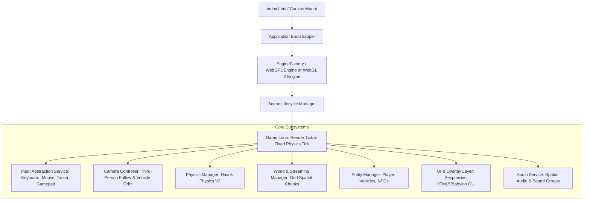

# PROJECT MEMORY & CENTRAL BRAIN: VICE-CITY (OPEN-WORLD 3D BROWSER ENGINE)

> **Document Type:** Persistent Agentic Memory & Central Navigation Hub  
> **Status:** Active & Authoritative  
> **Repository Location:** Project Root (`/brain.md`)  
> **Operating Protocol:** See [AGENTS.md](file:///D:/CodeSpace/Parmanent-Field/Vice-City/AGENTS.md)  
> **Last Verification Date:** 2026-11-04  

---

## 1. Project Identity and Vision

- **Project Codename:** Vice-City / Web Open World 3D (Original Intellectual Property)
- **Genre:** 3D Open-World Action-Adventure / Urban Exploration Sandbox
- **Core Vision:** An ambitious, highly optimized, browser-native 3D open-world game delivering responsive character locomotion, drivable vehicles, dynamic pedestrian/traffic simulation, missions, and atmospheric urban environments across desktop and mobile web browsers without plugins or downloads.
- **Originality Mandate:** 100% original IP. Clean-room development. Zero copyrighted assets, textures, character models, maps, dialogue, or audio from commercial games (e.g., Grand Theft Auto, Rockstar Games, Mafia, etc.).

---

## 2. Main Objective

To establish a production-grade, highly performant browser 3D engine foundation and vertical-slice open-world prototype capable of running at stable frame rates (target 60 FPS desktop / 30-60 FPS mobile) on modest hardware, maintaining clean architecture, zero memory leaks, and continuous verification.

---

## 3. Non-Negotiable Technical Decisions

The following technical selections are established project decisions (see [DECISIONS.md](file:///D:/CodeSpace/Parmanent-Field/Vice-City/docs/DECISIONS.md) for ADRs):

| Layer | Selected Technology | Rationale & Status |
|---|---|---|
| **Programming Language** | **TypeScript 5.x+ (Strict Mode)** | Enterprise type safety, zero `any`, compile-time validation. `[VERIFIED]` |
| **3D Engine** | **Babylon.js 7.x/8.x/9.x (`@babylonjs/core`)** | Industry-standard web engine with native WebGPU, complete physics abstraction, active maintenance. `[VERIFIED]` |
| **Build Toolchain** | **Vite 6.x/7.x/8.x** | Ultra-fast HMR, lightweight ES module bundling, minimal overhead. `[VERIFIED]` |
| **Primary Rendering** | **WebGPU** | Modern low-overhead graphics API, compute shaders, reduced CPU driver overhead. `[VERIFIED]` |
| **Fallback Rendering** | **WebGL 2** | Universal compatibility for older browsers/hardware via `EngineFactory.CreateAsync`. `[VERIFIED]` |
| **Physics Engine** | **Havok Physics V2 (`@babylonjs/havok`)** | High-performance WASM rigid body simulation, native character controller, MIT licensed. `[VERIFIED]` |
| **DCC & 3D Modeling** | **Blender 4.x+** | Industry-standard open-source 3D suite, native glTF 2.0 exporter. `[VERIFIED]` |
| **3D Asset Format** | **glTF 2.0 / GLB** | Standard format with KTX2 Basis Universal textures and Meshopt geometry compression. `[VERIFIED]` |
| **Target Platform** | **Desktop & Mobile Browsers** | Cross-platform web targeting Chromium, WebKit (Safari), and Gecko (Firefox). `[VERIFIED]` |

> [!WARNING]
> Do NOT replace this stack with Three.js, React Three Fiber, PlayCanvas, Unity WebGL, or Unreal Engine.

---

## 4. Hardware Constraints & Operational Realities

### Primary Workstation Profile
- **Model:** Lenovo IdeaPad Slim 3i
- **CPU:** Intel Core i3-1005G1 (10th Gen Ice Lake, 2 cores / 4 threads, 1.20 GHz base, 3.40 GHz turbo)
- **GPU:** Integrated Intel UHD Graphics G1 (32 Execution Units, shared system memory, zero dedicated VRAM)
- **RAM:** 8 GB DDR4 total (~3.5 GB consumed by Windows 11 26H2 background services; ~3.5 to 4.0 GB free for IDE, browser tab, and OS cache)
- **Storage:** 128 GB NVMe SSD (~80 GB free disk space)
- **OS:** Windows 11 Home 26H2

### Engineering Implications & Resource Budgets
- **CPU Budget:** 2 physical cores means physics, animation, and JS gameplay loops share CPU time. Offload rendering to WebGPU; keep physics tick lightweight (sub-4ms per frame).
- **RAM / VRAM Ceiling:** Tab crash threshold is approximately 1.5–2.0 GB. Target maximum active memory usage of **sub-1.0 GB** in browser tab.
- **Draw Call Limit:** Integrated Intel GPU fill-rate and draw-call bottleneck requires aggressive mesh merging, thin instancing, frustum culling, and LOD. Maximum target: **< 150 draw calls per frame** in the viewport.
- **Thermal Throttling:** Prolonged 100% CPU/GPU loads cause aggressive CPU clock throttling on slim chassis. Code must maintain low idle overhead.

---

## 5. High-Level Architecture Summary

The application architecture follows a decoupled, composition-based service topology:

See [docs/ARCHITECTURE.md](file:///D:/CodeSpace/Parmanent-Field/Vice-City/docs/ARCHITECTURE.md) for comprehensive structural specifications.

---

## 6. Master Documentation Index

All technical documents are stored in `/docs` and maintained under strict versioning:

1. [AGENTS.md](file:///D:/CodeSpace/Parmanent-Field/Vice-City/AGENTS.md) — Mandatory AI coding agent operating protocol, startup checklist, and rules.
2. [README.md](file:///D:/CodeSpace/Parmanent-Field/Vice-City/README.md) — Public repository overview, getting started guide, and project summary.
3. [docs/PRD.md](file:///D:/CodeSpace/Parmanent-Field/Vice-City/docs/PRD.md) — Product Requirements Document: gameplay, platform targets, acceptance criteria.
4. [docs/ARCHITECTURE.md](file:///D:/CodeSpace/Parmanent-Field/Vice-City/docs/ARCHITECTURE.md) — Software architecture, subsystem topology, lifecycle, and memory management.
5. [docs/SYSTEM_DESIGN.md](file:///D:/CodeSpace/Parmanent-Field/Vice-City/docs/SYSTEM_DESIGN.md) — Detailed design for locomotion, vehicles, traffic, AI, missions, and world streaming.
6. [docs/TECH_STACK.md](file:///D:/CodeSpace/Parmanent-Field/Vice-City/docs/TECH_STACK.md) — In-depth evaluation, version records, and licensing for all dependencies.
7. [docs/ROADMAP.md](file:///D:/CodeSpace/Parmanent-Field/Vice-City/docs/ROADMAP.md) — Multi-phase milestones from Phase 0 foundation to Phase 10 release.
8. [docs/DECISIONS.md](file:///D:/CodeSpace/Parmanent-Field/Vice-City/docs/DECISIONS.md) — Architectural Decision Records (ADRs) with rationale and trade-offs.
9. [docs/RESEARCH_SOURCES.md](file:///D:/CodeSpace/Parmanent-Field/Vice-City/docs/RESEARCH_SOURCES.md) — Verified library of authoritative documentation and specifications.
10. [docs/RISKS.md](file:///D:/CodeSpace/Parmanent-Field/Vice-City/docs/RISKS.md) — Technical and project risk register with mitigation strategies.
11. [docs/DEVELOPMENT_WORKFLOW.md](file:///D:/CodeSpace/Parmanent-Field/Vice-City/docs/DEVELOPMENT_WORKFLOW.md) — 10-step development protocol, code quality, testing standards.
12. [docs/ASSET_PIPELINE.md](file:///D:/CodeSpace/Parmanent-Field/Vice-City/docs/ASSET_PIPELINE.md) — Blender-to-glTF standards, texture budgets, LOD, and licensing governance.

---

## 7. Current Verified Implementation Status

| Component | Status | Codebase Verification Details |
|---|---|---|
| Project Git Repository | `[VERIFIED]` | Initialized clean Git tracking on branch `main` / `master`. |
| Project Memory System | `[VERIFIED]` | Complete documentation suite established in root and `docs/`. |
| Build Toolchain (`package.json`, Vite) | `[NOT_STARTED]` | Not yet initialized; scheduled for Phase 1. |
| Engine Bootstrapper | `[NOT_STARTED]` | Scheduled for Phase 1. |
| Scene & Canvas Mount | `[NOT_STARTED]` | Scheduled for Phase 1. |
| Havok WASM Setup | `[NOT_STARTED]` | Scheduled for Phase 1 / Phase 4. |
| Player Locomotion | `[PROPOSED]` | Architectural design documented; no code written yet. |
| Vehicle Simulation | `[PROPOSED]` | Architectural design documented; no code written yet. |
| Traffic & NPC Simulation | `[PROPOSED]` | Architectural design documented; no code written yet. |

---

## 8. Development State

- **Current Development Phase:** **Phase 0: Engineering Foundation, Research & Persistent Memory**
- **Last Completed Task:** `TASK 001: Establish Complete Engineering Foundation and Project Memory System`
- **Current Active Task:** `TASK 001 Review and Verification`
- **Next Approved Task:** `TASK 002: Minimal Build Toolchain Setup (Vite + Strict TypeScript + Babylon.js Dual-Engine Bootstrapper)`

---

## 9. Known Bugs, Technical Blockers & Limitations

1. **Hardware Limitation:** Intel Core i3-1005G1 has only 2 physical cores and integrated UHD G1 graphics. Heavy shader compilation causes brief frame drops unless precached.
2. **WebGPU Platform Variance:** WebGPU is supported natively on modern Windows Chrome/Edge/Firefox and macOS/iOS Safari, but Linux and certain older mobile devices require WebGL 2 fallback.
3. **Havok WASM Loading in Vite:** Bundling WASM binaries in Vite requires specific MIME configuration or top-level await plugins to prevent 404 or compilation MIME mismatches.
4. **Current Repository State:** Zero code files exist yet. Do not attempt to run build commands until Phase 1 scaffolds `package.json`.

---

## 10. Unresolved Technical Decisions (Open Questions)

- **UQ-001 (Physics Character Controller vs Kinematic Collider):** Decide whether to use Babylon.js V2 built-in `PhysicsCharacterController` with Havok queries or a custom kinematic swept-sphere/raycast controller for maximum determinism and slope handling.
- **UQ-002 (Vehicle Architecture: Raycast Suspension vs 6DoF Havok Rig):** Benchmark raycast spring suspension (low CPU, high stability) versus full Havok 6DoF rigid-body constraints on target hardware.
- **UQ-003 (UI Framework Selection):** Evaluate lightweight HTML/CSS DOM overlays versus `@babylonjs/gui` for mobile touch buttons and HUD performance.

---

## 11. Critical Warnings & Agent Guardrails

1. **NEVER hallucinate code status:** If a file does not exist on disk, do not tell the user it is working.
2. **NEVER add commercial GTA assets:** Do not import models, names, audio, or textures from Grand Theft Auto or other commercial IPs.
3. **NEVER introduce heavy dependencies casually:** Every npm package must be justified, checked for bundle size, and verified for licensing.
4. **NEVER skip disposal logic:** Any entity or mesh created must be cleanly disposed of when destroyed or streamed out.

---

## 12. Verification & Audit Trail

- **Document Version:** 1.0.0
- **Audited By:** Principal Software Architect & AI Agent
- **Audit Timestamp:** 2026-11-04T19:12:00+05:30
- **Integrity Status:** `[VERIFIED]` consistent with repository files on disk.
