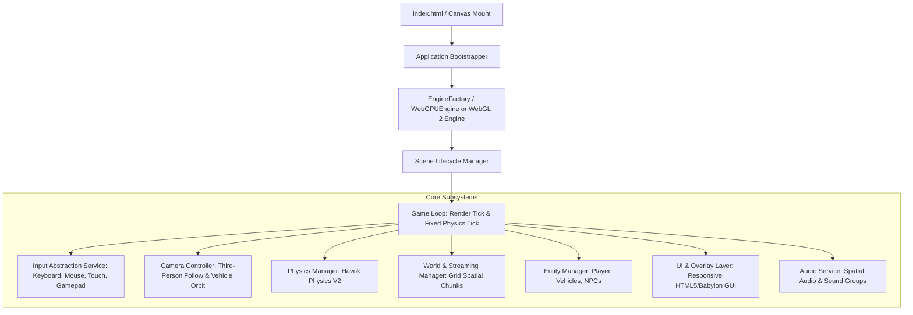

# PROJECT MEMORY & CENTRAL BRAIN: VICE-CITY (OPEN-WORLD 3D BROWSER ENGINE)

> **Document Type:** Persistent Agentic Memory & Central Navigation Hub  
> **Status:** Active & Authoritative  
> **Repository Location:** Project Root (`/brain.md`)  
> **Operating Protocol:** See [AGENTS.md](AGENTS.md)  
> **Last Verification Date:** 2026-11-18  

---

## 1. Project Identity and Vision

- **Project Codename:** Vice-City / Web Open World 3D (Original Intellectual Property)
- **Genre:** 3D Open-World Action-Adventure / Urban Exploration Sandbox
- **Core Vision:** An ambitious, highly optimized, browser-native 3D open-world game delivering responsive character locomotion, drivable vehicles, dynamic pedestrian/traffic simulation, missions, and atmospheric urban environments across desktop and mobile web browsers without plugins or downloads.
- **Originality Mandate:** 100% original IP. Clean-room development. Zero copyrighted assets, textures, character models, maps, dialogue, or audio from commercial games (e.g., Grand Theft Auto, Rockstar Games, Mafia, etc.).

---

## 2. Main Objective

To establish a production-grade, highly performant browser 3D engine foundation and vertical-slice open-world prototype capable of running at stable frame rates (target 60 FPS desktop / 30-60 FPS mobile, pending empirical benchmark calibration) on modest hardware, maintaining clean architecture, zero memory leaks, and continuous verification.

---

## 3. Non-Negotiable Technical Decisions

The following technical selections are established project decisions (see [docs/DECISIONS.md](docs/DECISIONS.md) for ADRs):

| Layer | Selected Technology | Rationale & Status |
|---|---|---|
| **Programming Language** | **TypeScript (Strict Mode)** | Enterprise type safety, zero `any`, compile-time validation. `[VERIFIED]` |
| **3D Engine** | **Babylon.js (`@babylonjs/core`)** | Industry-standard web engine with native WebGPU, complete physics abstraction, active maintenance. `[VERIFIED]` |
| **Build Toolchain** | **Vite** | Ultra-fast HMR, lightweight ES module bundling, minimal overhead. `[VERIFIED]` |
| **Primary Rendering** | **WebGPU** | Modern low-overhead graphics API, compute shaders, reduced CPU driver overhead where supported. `[VERIFIED]` |
| **Fallback Rendering** | **WebGL 2** | Universal compatibility for older browsers/hardware and devices lacking WebGPU support. `[VERIFIED]` |
| **Physics Engine** | **Havok Physics V2 (`@babylonjs/havok`)** | High-performance WASM rigid body simulation, native character controller, MIT licensed. `[VERIFIED]` |
| **DCC & 3D Modeling** | **Blender 4.x+** | Industry-standard open-source 3D suite, native glTF 2.0 exporter. `[VERIFIED]` |
| **3D Asset Format** | **glTF 2.0 / GLB** | Standard format with KTX2 Basis Universal textures and Meshopt geometry compression. `[VERIFIED]` |
| **Target Platform** | **Desktop & Mobile Browsers** | Cross-platform web targeting Chromium, WebKit (Safari), and Gecko (Firefox). `[VERIFIED]` |

> [!WARNING]
> Do NOT replace this stack with Three.js, React Three Fiber, PlayCanvas, Unity WebGL, or Unreal Engine.

---

## 4. Hardware Constraints & Operational Realities

### Primary Workstation Profile
- **Model:** Lenovo IdeaPad Slim 3i
- **CPU:** Intel Core i3-1005G1 (10th Gen Ice Lake, 2 cores / 4 threads, 1.20 GHz base, 3.40 GHz turbo)
- **GPU:** Integrated Intel UHD Graphics G1 (32 Execution Units, shared system memory, zero dedicated VRAM)
- **RAM:** 8 GB DDR4 total (~3.5 GB consumed by Windows 11 26H2 background services; ~3.5 to 4.0 GB free for IDE, browser tab, and OS cache)
- **Storage:** 128 GB NVMe SSD (~80 GB free disk space)
- **OS:** Windows 11 Home 26H2

### Engineering Hypotheses & Resource Budgets (To Be Empirically Measured)
> [!NOTE]
> All numerical limits below are **design hypotheses `[PROPOSED]`** established for planning purposes. None represent measured constraints or guaranteed browser allocations until empirical benchmarks are completed on target hardware.

- **CPU Budget Hypothesis:** 2 physical cores means physics, animation, and JS gameplay loops share CPU time. Physics is proposed to tick at a 60 Hz target (`[PROPOSED]`), with sub-4ms tick time hypothesis.
- **RAM / VRAM Ceiling Hypothesis:** Proposed active browser tab memory target of **sub-1.0 GB `[PROPOSED]`** to prevent tab discards under Windows memory pressure (actual threshold is browser/OS-dependent, not guaranteed).
- **Draw Call Hypothesis:** Integrated Intel GPU fill-rate and draw-call bottleneck requires aggressive mesh merging, thin instancing, frustum culling, and LOD. Proposed planning target: **< 150 draw calls per frame `[PROPOSED]`** in the viewport.
- **Spatial Chunk Hypothesis:** World grid chunk size of **64m × 64m `[PROPOSED]`** is an initial spatial hypothesis subject to chunk streaming benchmarks.
- **Traffic & Crowd Simulation Hypothesis:** Max 12 active vehicles and 20 pedestrians `[PROPOSED]` are initial scaling hypotheses to be validated through CPU profiling.
- **Thermal Throttling:** Prolonged 100% CPU/GPU loads cause aggressive CPU clock throttling on slim chassis. Code must maintain low idle overhead.

---

## 5. High-Level Architecture Summary

The application architecture follows a decoupled, composition-based service topology:

See [docs/ARCHITECTURE.md](docs/ARCHITECTURE.md) for comprehensive structural specifications.

---

## 6. Master Documentation Index

All technical documents are stored in `/docs` and maintained under strict versioning:

1. [AGENTS.md](AGENTS.md) — Mandatory AI coding agent operating protocol, startup checklist, and rules.
2. [README.md](README.md) — Public repository overview, getting started guide, and project summary.
3. [docs/PRD.md](docs/PRD.md) — Product Requirements Document: gameplay, platform targets, acceptance criteria.
4. [docs/ARCHITECTURE.md](docs/ARCHITECTURE.md) — Software architecture, subsystem topology, lifecycle, and memory management.
5. [docs/SYSTEM_DESIGN.md](docs/SYSTEM_DESIGN.md) — Detailed design for locomotion, vehicles, traffic, AI, missions, and world streaming.
6. [docs/TECH_STACK.md](docs/TECH_STACK.md) — In-depth evaluation, version records, and licensing for all dependencies.
7. [docs/ROADMAP.md](docs/ROADMAP.md) — Multi-phase milestones from Phase 0 foundation to Phase 10 release.
8. [docs/DECISIONS.md](docs/DECISIONS.md) — Architectural Decision Records (ADRs) with rationale and trade-offs.
9. [docs/RESEARCH_SOURCES.md](docs/RESEARCH_SOURCES.md) — Verified library of authoritative documentation and specifications.
10. [docs/RISKS.md](docs/RISKS.md) — Technical and project risk register with mitigation strategies.
11. [docs/DEVELOPMENT_WORKFLOW.md](docs/DEVELOPMENT_WORKFLOW.md) — 10-step development protocol, code quality, testing standards.
12. [docs/ASSET_PIPELINE.md](docs/ASSET_PIPELINE.md) — Blender-to-glTF standards, texture budgets, LOD, and licensing governance.

---

## 7. Current Verified Implementation Status

| Component | Status | Codebase Verification Details |
|---|---|---|
| Project Git Repository | `[VERIFIED]` | Local branch `feature/task-002-rendering-foundation` tracking `origin/main`; connected to remote `origin` (https://github.com/chandanbag1999/vice-city.git). |
| Project Memory System | `[VERIFIED]` | Complete documentation suite established in root and `docs/` with portable relative Markdown links. |
| Build Toolchain (`package.json`, Vite, TS) | `[VERIFIED]` | `package.json`, `pnpm-lock.yaml`, strict `tsconfig.json`, and `vite.config.ts` pinned (`@babylonjs/core` 9.35.0, `typescript` 7.0.2, `vite` 8.3.7). |
| Engine Bootstrapper | `[VERIFIED]` | `src/core/EngineFactory.ts` with asynchronous WebGPU probing, WebGPUEngine init, explicit partial-failure disposal, and WebGL 2 fallback. |
| Scene & Canvas Mount | `[VERIFIED]` | `index.html`, `styles/main.css`, `src/scene/createTestScene.ts`, and `src/main.ts` running at 60 FPS in Chrome 157 with context loss/restore handlers. |
| Telemetry Overlay | `[VERIFIED]` | `src/ui/Telemetry.ts` displaying live backend, instant/rolling FPS, active meshes, buffer resolution, DPR, and lifecycle status. |
| Havok WASM Setup | `[NOT_STARTED]` | Explicitly deferred to Phase 4 (physics integration milestone). |
| Player Locomotion | `[PROPOSED]` | Architectural design documented; no code written yet. |
| Vehicle Simulation | `[PROPOSED]` | Architectural design documented; no code written yet. |
| Traffic & NPC Simulation | `[PROPOSED]` | Architectural design documented; no code written yet. |
| Mobile Physical Compatibility | `[UNVERIFIED]` | Browser touch viewport meta configured; physical device benchmark pending. |

---

## 8. Development State

- **Current Development Phase:** **Phase 1: Minimal Browser Rendering & Device Compatibility `[COMPLETED]`**
- **Last Completed Task:** `TASK 002.1: Final Foundation Audit, Verification, Documentation Synchronization & GitHub Publication [VERIFIED]`
  - Audited full codebase and resolved unhandled resource disposal in `EngineFactory.ts` catch block.
  - Added graphics context loss (`onContextLostObservable`) and restoration (`onContextRestoredObservable`) observers in `main.ts` connected to `Telemetry.setStatus()`.
  - Added duplicate render loop prevention (`engine.stopRenderLoop()`) and explicit teardown in `main.ts`.
  - Performed rigorous headless Chrome 157.0.8103.39 browser CDP tests on production build:
    - WebGPU Primary: 60 FPS instant, 54 FPS rolling average, 5 active meshes, 1262×568 buffer, Status "Running".
    - WebGL 2 Fallback: 60 FPS instant, 59 FPS rolling average, 5 active meshes, 1262×624 buffer, Status "Running".
  - Verified package versions: `@babylonjs/core` 9.35.0, `typescript` 7.0.2, `vite` 8.3.7.
  - Verified `pnpm install --frozen-lockfile` (0 changes), `pnpm exec tsc --noEmit` (0 errors), `pnpm run build` (clean 3.73s build).
- **Current Active Task:** `TASK 002.1: Final Foundation Audit, Verification, Documentation Synchronization & GitHub Publication`
- **Next Approved Task:** `TASK 003: Modular City Block Environment Prototype (Test District with PBR Materials & Instancing)` (Awaiting explicit review and user approval)

---

## 9. Known Bugs, Technical Blockers & Limitations

1. **Hardware Limitation:** Intel Core i3-1005G1 has only 2 physical cores and integrated UHD G1 graphics. Heavy shader compilation causes brief frame drops unless precached.
2. **WebGPU Platform Variance:** WebGPU is supported natively on modern Windows Chrome/Edge/Firefox and macOS/iOS Safari, but Linux and certain older mobile devices require WebGL 2 fallback.
3. **WebGPU Telemetry Metric:** Babylon.js `WebGPUEngine` does not currently expose a single scalar `drawCalls` property; telemetry correctly displays `"N/A"` rather than inventing an unverified count.
4. **Context Dependency:** WebGPU requires a secure context (`https://` or `localhost`). In insecure HTTP contexts, the engine automatically falls back to WebGL 2.
5. **Mobile Physical Verification:** Mobile browser touch and GPU compatibility remains `[UNVERIFIED]` until physical iOS/Android device testing is conducted.

---

## 10. Unresolved Technical Decisions (Open Questions)

- **UQ-001 (Physics Character Controller vs Kinematic Collider):** Decide whether to use Babylon.js V2 built-in `PhysicsCharacterController` with Havok queries or a custom kinematic swept-sphere/raycast controller for maximum determinism and slope handling.
- **UQ-002 (Vehicle Architecture: Raycast Suspension vs 6DoF Havok Rig):** Benchmark raycast spring suspension (low CPU, high stability) versus full Havok 6DoF rigid-body constraints on target hardware.
- **UQ-003 (UI Framework Selection):** Evaluate lightweight HTML/CSS DOM overlays versus `@babylonjs/gui` for mobile touch buttons and HUD performance.

---

## 11. Critical Warnings & Agent Guardrails

1. **NEVER hallucinate code status:** If a file does not exist on disk, do not tell the user it is working.
2. **NEVER add commercial GTA assets:** Do not import models, names, audio, or textures from Grand Theft Auto or other commercial IPs.
3. **NEVER introduce heavy dependencies casually:** Every npm package must be justified, checked for bundle size, and verified for licensing.
4. **NEVER skip disposal logic:** Any entity or mesh created must be cleanly disposed of when destroyed or streamed out.

---

## 12. Verification & Audit Trail

- **Document Version:** 1.2.0
- **Audited By:** Senior Browser Game Engineer & Software Architect
- **Audit Timestamp:** 2026-11-18T20:35:00+05:30
- **Integrity Status:** `[VERIFIED]` complete foundation audit and empirical browser tests passed.

- **Document Version:** 1.1.0
- **Audited By:** Senior TypeScript & Babylon.js Rendering Engineer / Software Architect
- **Audit Timestamp:** 2026-11-11T00:58:00+05:30
- **Integrity Status:** `[VERIFIED]` consistent with working implementation on disk.

- **Document Version:** 1.0.0
- **Audited By:** Principal Software Architect & AI Agent
- **Audit Timestamp:** 2026-11-11T00:00:00+05:30
- **Integrity Status:** `[VERIFIED]` consistent with repository files on disk.
