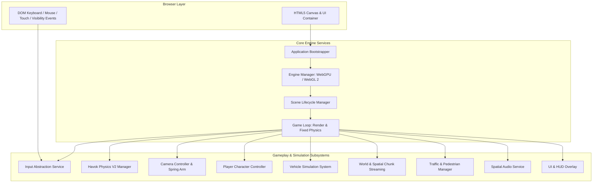
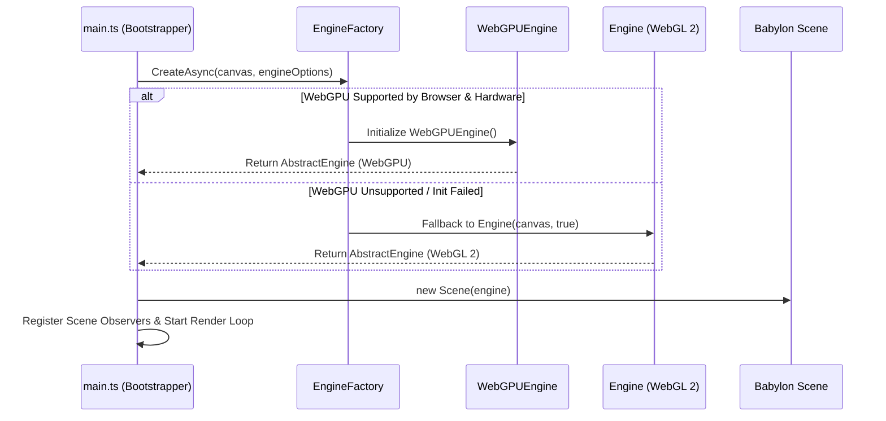
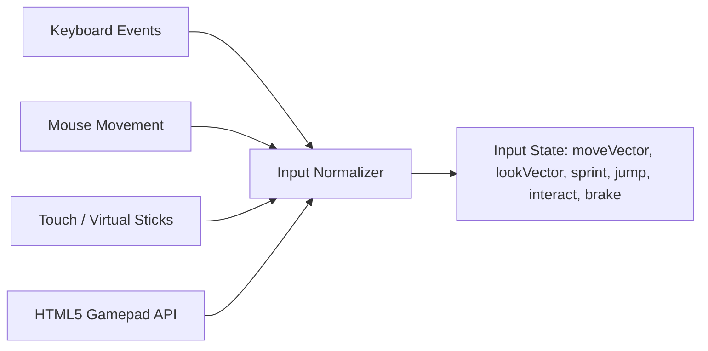
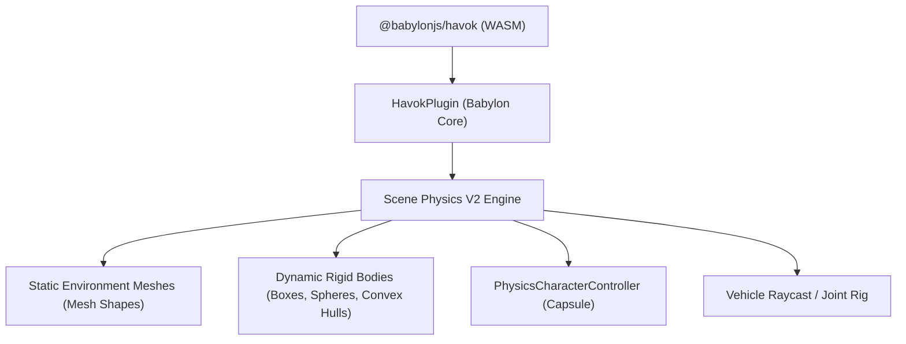
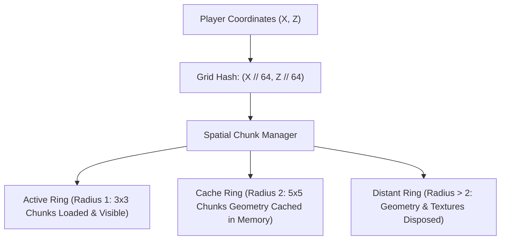

# System Architecture Specification — Vice-City Engine

> **Document Type:** Software & Engine Architecture  
> **Status:** `[PROPOSED]` / Authoritative Technical Specification  
> **Target Platform:** Web (Desktop & Mobile)  
> **Primary Technologies:** TypeScript, Babylon.js, WebGPU / WebGL 2, Havok Physics V2  
> **Last Verified Date:** 2026-11-04  

---

## 1. Architectural Philosophy & Principles

The Vice-City game engine architecture is built upon five foundational engineering principles:

1. **Progressive Rendering & Graceful Fallback:** Never hard-code WebGPU as an exclusive requirement. Always initialize via Babylon's `EngineFactory.CreateAsync` with automatic WebGL 2 fallback.
2. **Explicit Memory & Lifecycle Management:** Browsers do not automatically clean up GPU buffers or WebAssembly memory allocations. Every object created must implement an explicit `dispose()` lifecycle method.
3. **Decoupled Service Composition:** Rather than adopting a complex, boilerplate-heavy Entity-Component-System (ECS) framework or deep inheritance hierarchies, subsystems operate as cohesive, decoupled services coordinated by a central `GameWorld` director.
4. **Platform-Agnostic Input Normalization:** Gameplay systems never listen directly to DOM keyboard or touch events. All hardware inputs feed into an `InputService` that emits standardized directional axes and abstract gameplay actions.
5. **Fixed-Timestep Physics Simulation:** Visual rendering runs variable delta-time (interpolated), while the physics simulation (Havok) ticks at a deterministic fixed rate (60 Hz) to maintain simulation stability on low-power CPUs.

---

## 2. Global Subsystem Topology



---

## 3. Application Bootstrap & Engine Selection

The application entry point bootstraps asynchronously to probe hardware features and initialize the optimal rendering backend:



### Technical Implementation Pattern:
```typescript
import { EngineFactory } from "@babylonjs/core/Engines/engineFactory";
import { Scene } from "@babylonjs/core/scene";
import { AbstractEngine } from "@babylonjs/core/Engines/abstractEngine";

export class EngineBootstrap {
    public static async initialize(canvas: HTMLCanvasElement): Promise<{ engine: AbstractEngine; scene: Scene }> {
        // Automatically probes WebGPU capabilities, falling back to WebGL 2 if unavailable
        const engine = await EngineFactory.CreateAsync(canvas, {
            antialias: true,
            adaptToDeviceRatio: true,
            powerPreference: "high-performance",
            audioEngine: true
        });

        const scene = new Scene(engine);
        return { engine, scene };
    }
}
```

---

## 4. Main Game Loop & Execution Order

To eliminate simulation stuttering and ensure deterministic collision results across varying frame rates, the game loop cleanly separates rendering ticks from physics ticks:

```text
Every Frame (requestAnimationFrame):
│
├── 1. Read Raw DOM Inputs & Update InputService (Axes, Buttons)
├── 2. Step Physics Simulation (Havok fixed timestep @ 60 Hz)
├── 3. Update Spatial Grid & Stream Nearby Chunks
├── 4. Update Active Entities (Player, Vehicles, NPC AI)
├── 5. Update Camera Rig (Follow position, spring-arm collision probe)
├── 6. Update Audio Listener Position & Sound Emitters
├── 7. Dispatch UI State Updates (Speedometer, Mini-map coordinates)
└── 8. Render Babylon.js Scene (Babylon scene.render())
```

### Deterministic Physics Ticking:
Havok Physics V2 runs using an internal sub-step accumulator:
```typescript
havokPlugin.setTimeStep(1 / 60); // Deterministic 60 Hz simulation
scene.onBeforeRenderObservable.add(() => {
    const deltaTime = scene.getEngine().getDeltaTime() / 1000.0;
    // Cap maximum delta time to prevent "spiral of death" during lag spikes
    const clampedDelta = Math.min(deltaTime, 0.1);
    // Entity logic updates here
});
```

---

## 5. Input Abstraction Architecture

The game decouples raw input devices from game actions. Whether playing via Keyboard, Mouse, Touch, or Gamepad, gameplay code queries the normalized `InputService`:



### Action Schema:
- `moveVector: Vector2` (Normalized -1.0 to +1.0 for lateral and forward movement)
- `lookVector: Vector2` (Yaw and Pitch delta angles)
- `isSprinting: boolean`
- `isJumping: boolean`
- `isInteracting: boolean` (Vehicle enter/exit, NPC talk)
- `handbrake: boolean`

---

## 6. Camera Architecture & Obstacle Avoidance

The camera system uses a state-driven **Spring-Arm Third-Person Camera Controller**:

1. **Target Attachment:** Binds smoothly to an anchor node (`TransformNode`) situated at the character's chest or vehicle center-of-mass.
2. **Spherical Coordinate Orbit:** Yaw and pitch are modulated by mouse or touch look inputs, with pitch clamped between -20° (looking upward) and +65° (looking downward).
3. **Collision / Occlusion Raycast:** A continuous sphere-cast runs from the target anchor to the desired camera position against environmental collision layers. If a wall or ceiling is detected, the camera distance is shortened smoothly to prevent geometry clipping.
4. **Vehicle Camera Mode:** Switches automatically to a higher speed-dependent follow distance, dynamic field-of-view (FOV) expansion (e.g., 60° at rest up to 75° at top speed), and angular damping.

---

## 7. Physics Architecture (Havok Physics V2)

Babylon.js Physics V2 is powered by the `@babylonjs/havok` WebAssembly engine:



### Collision Filtering Layers:
To ensure high simulation performance, collision filters are partitioned via bitmasks:
- `Layer 0 (0x0001):` Static World Geometry (Roads, Buildings, Curbs)
- `Layer 1 (0x0002):` Player Character Capsule
- `Layer 2 (0x0004):` Vehicles (Drivable & Traffic)
- `Layer 3 (0x0008):` Dynamic Props (Barrels, Crates, Street Signs)
- `Layer 4 (0x0010):` Interaction Triggers (Vehicle Doors, Mission Checkpoints)
- `Layer 5 (0x0020):` Pedestrian NPCs

---

## 8. Entity & Component Organization

Instead of a heavy external ECS library, entities are implemented as modular composition units implementing a standardized `IGameEntity` lifecycle:

```typescript
export interface IGameEntity {
    readonly id: string;
    readonly transform: TransformNode;
    update(deltaTime: number): void;
    dispose(): void;
}
```

### Standard Entity Types:
1. `PlayerEntity`: Manages character visual mesh, animation blending, Havok `PhysicsCharacterController`, and input handling.
2. `VehicleEntity`: Manages chassis mesh, 4 wheel meshes, raycast suspension physics, sound pitch, and driver seating state.
3. `PropEntity`: Lightweight dynamic or static interactive world prop with rigid body physics.
4. `TrafficAgentEntity`: Simplified kinematic vehicle conforming to road waypoints with raycast forward avoidance.

---

## 9. World Organization & Spatial Chunk Streaming

To maintain 60 FPS within an 8 GB shared-memory envelope, the urban environment is divided into an infinite or bounded 2D spatial grid:



- **Chunk Size:** 64 meters × 64 meters per block.
- **LOD Strategy:**
  - **LOD 0 (Near, 0–60m):** High-detail buildings with door/window geometry, street furniture, active physics colliders.
  - **LOD 1 (Medium, 60–150m):** Simplified building facades, simplified materials, colliders disabled.
  - **LOD 2 (Far, 150m–300m):** Single combined low-poly billboard / box impostors.
- **Mesh Instancing:** Repetitive elements (palm trees, street lights, trash bins, modular road tiles) use Babylon.js `Thin Instances` or `Mesh.createInstance` to combine hundreds of objects into single draw calls.

---

## 10. Resource Lifecycle & Garbage Collection Prevention

WebGPU and WebGL GPU buffers must be explicitly released:

1. **Asset Disposal:** When a chunk is unloaded:
   ```typescript
   mesh.dispose(false, true); // Dispose mesh geometry and child materials
   ```
2. **Texture Unloading:** Inactive textures call `texture.dispose()` to immediately free GPU memory.
3. **Scratch Vector Allocation:** In-loop allocations are strictly forbidden:
   ```typescript
   // WRONG: Allocates a new heap object every frame (triggers GC pauses)
   const dir = new Vector3(dx, dy, dz);

   // CORRECT: Pre-allocated static scratch instance
   private static readonly _scratchVector = new Vector3();
   ```

---

## 11. Context-Loss Recovery Architecture

Web browsers can terminate the GPU device under severe memory pressure or OS sleep events:

```typescript
export function registerContextLossHandlers(engine: AbstractEngine, scene: Scene): void {
    // WebGL Context Loss Handler
    const canvas = engine.getRenderingCanvas();
    if (canvas) {
        canvas.addEventListener("webglcontextlost", (event) => {
            event.preventDefault();
            console.warn("[Engine] WebGL Context Lost! Pausing simulation...");
            engine.stopRenderLoop();
        });

        canvas.addEventListener("webglcontextrestored", () => {
            console.info("[Engine] WebGL Context Restored! Reinitializing scene assets...");
            // Trigger asset reload sequence
        });
    }
}
```

---

## 12. Performance Telemetry & Instrumentation

The engine incorporates a non-intrusive runtime telemetry collector:
- **`engine.getFps()`**: Real-time frames per second.
- **`scene.getEngine().drawCalls`**: Total draw calls dispatched in current frame.
- **`scene.getActiveMeshes().length`**: Number of meshes passing frustum culling.
- **`performance.memory?.usedJSHeapSize`**: Active JS heap footprint (Chromium).
- Real-time display available via diagnostic overlay toggled by `F3` key.
