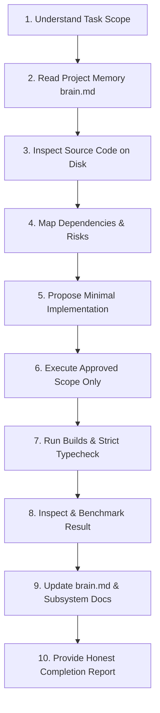

# Standard Engineering Development Workflow — Vice-City Engine

> **Document Type:** Development Process & Quality Standard  
> **Status:** Mandatory Engineering Protocol  
> **Repository Location:** `/docs/DEVELOPMENT_WORKFLOW.md`  
> **Target Audience:** All Engineers & AI Coding Agents  
> **Last Verified Date:** 2026-11-04  

---

## 1. The 10-Step Development Lifecycle

Every technical task—whether executed by a human engineer or an AI coding agent—must follow this strict 10-step protocol to prevent regressions, context drift, and unverified assumptions:



---

### Step 1: Understand the Task Scope
- Carefully read the user request or ticket.
- Determine whether the task is architectural planning, configuration, asset preparation, or code implementation.
- Identify explicit non-goals: what must *not* be touched or implemented during this task.

### Step 2: Read Project Memory & Context
- Read root [`brain.md`](file:///D:/CodeSpace/Parmanent-Field/Vice-City/brain.md) in full using file-reading tools.
- Read linked subsystem documentation in `/docs` relevant to the task (e.g., [`ARCHITECTURE.md`](file:///D:/CodeSpace/Parmanent-Field/Vice-City/docs/ARCHITECTURE.md), [`SYSTEM_DESIGN.md`](file:///D:/CodeSpace/Parmanent-Field/Vice-City/docs/SYSTEM_DESIGN.md), [`TECH_STACK.md`](file:///D:/CodeSpace/Parmanent-Field/Vice-City/docs/TECH_STACK.md)).
- Review current development phase in [`ROADMAP.md`](file:///D:/CodeSpace/Parmanent-Field/Vice-City/docs/ROADMAP.md).

### Step 3: Inspect Relevant Code on Disk
- Execute `git status` to verify current branch and detect uncommitted work.
- Inspect directory trees and read relevant source files directly.
- **Rule of Reality:** If documentation contradicts files on disk, code on disk is the ground truth. Report the contradiction immediately.

### Step 4: Map Dependencies & Blockers
- Identify required libraries, engine modules, or assets.
- Verify that prerequisite roadmap phases have passed their verification gates.
- Do not proceed if an unresolved dependency or technical blocker exists.

### Step 5: Propose Minimal Implementation
- Outline the minimal, modular code changes required to satisfy the task.
- Ensure the proposal avoids premature abstraction, unnecessary third-party packages, and memory leaks.

### Step 6: Execute Approved Scope Only
- Modify or create files within the approved boundary.
- Adhere strictly to TypeScript strict mode guidelines (`noImplicitAny: true`, `strictNullChecks: true`).
- Follow Babylon.js granular ES6 module import conventions.
- Implement explicit `.dispose()` methods for all allocated 3D resources.

### Step 7: Run Builds, Linting & Type Checks
- Execute strict TypeScript compilation: `npx tsc --noEmit`.
- Run production build test: `npm run build`.
- If automated unit or integration tests exist, execute the test runner (`npm test`).
- Ensure zero errors and zero unhandled warnings.

### Step 8: Inspect & Benchmark Results
- Test the application locally using `npm run dev` or `npm run preview`.
- Check browser console for WebGPU warnings, shader compilation errors, or context loss messages.
- Verify memory stability and draw calls using the Babylon Inspector or runtime telemetry overlay.

### Step 9: Update Project Memory & Documentation
- Update [`brain.md`](file:///D:/CodeSpace/Parmanent-Field/Vice-City/brain.md):
  - Record the completed work under `Last Completed Task`.
  - Update `Current Active Task` and `Next Approved Task`.
  - Note any newly discovered bugs or technical limitations.
  - Update `Last Verification Date`.
- If a major architectural decision was made, document it as a new ADR in [`DECISIONS.md`](file:///D:/CodeSpace/Parmanent-Field/Vice-City/docs/DECISIONS.md).
- If risks evolved, update [`RISKS.md`](file:///D:/CodeSpace/Parmanent-Field/Vice-City/docs/RISKS.md).

### Step 10: Provide Honest Completion Report
- State clearly what was implemented, what was verified, and what remains pending.
- Use explicit reliability tags: `[VERIFIED]`, `[PROPOSED]`, `[UNVERIFIED]`.
- Recommend exactly one logical next step aligned with the roadmap.

---

## 2. Code Quality & Engineering Conventions

### 2.1 Strict TypeScript Standards
- **Zero `any`:** `any` is strictly prohibited. Use strong interfaces, discriminated unions, or `unknown` with runtime type assertions.
- **Granular Imports:** Never import from the monolithic bundle:
  ```typescript
  // WRONG: Pollutes bundle, breaks tree-shaking
  import * as BABYLON from "babylonjs";

  // CORRECT: Modular ES6 tree-shakeable imports
  import { Scene } from "@babylonjs/core/scene";
  import { Vector3 } from "@babylonjs/core/Maths/math.vector";
  import { MeshBuilder } from "@babylonjs/core/Meshes/meshBuilder";
  ```

### 2.2 Memory & Allocation Rules
- **Pre-allocate Vectors:** Never instantiate new objects inside per-frame loops (`onBeforeRenderObservable`, `runRenderLoop`):
  ```typescript
  // CORRECT: Static reusable scratch variables
  private static readonly _tempDir = new Vector3();
  ```
- **Mandatory Teardown:** Every class creating meshes, textures, observers, or physics bodies must implement:
  ```typescript
  public dispose(): void {
      this._mesh.dispose(false, true);
      this._observer?.remove();
  }
  ```

---

## 3. Git Version Control Standards

- **Branching:** Work proceeds on feature branches (`feature/phase1-bootstrapper`, `fix/camera-collision`) branching from `main`.
- **Commit Messages:** Follow conventional commit format:
  - `feat: implement dual WebGPU/WebGL 2 engine bootstrapper`
  - `fix: resolve Havok character slope sliding jitter`
  - `docs: update brain.md and roadmap for Phase 1 completion`
- **Clean Diffs:** Never commit generated build artifacts (`/dist`, `/node_modules`, `.cache`) or uncompressed raw textures.
