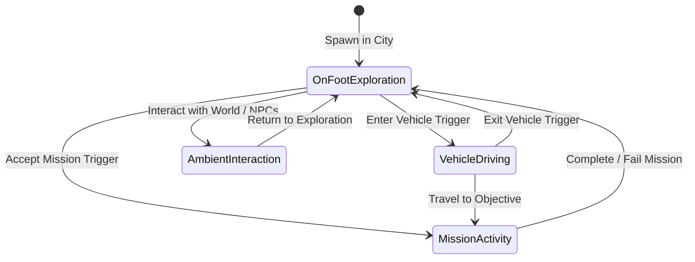

# Product Requirements Document (PRD) — Vice-City: Web Open World 3D

> **Document Type:** Product Requirements Document  
> **Status:** `[PROPOSED]` / Authoritative Planning Baseline  
> **Target Milestones:** Prototype (Phase 1–4) & Vertical Slice (Phase 5–8)  
> **Last Verified Date:** 2026-11-04  

---

## 1. Executive Summary & Product Vision

**Vice-City** is an original, ambitious, web-native 3D open-world action-adventure game. It brings the depth, freedom, and kinetic joy of urban exploration games into modern web browsers without installation, external launchers, or plugins.

Players enter an original coastal city featuring neon aesthetics, sun-drenched boulevards, industrial docks, and varied urban quarters. The game delivers smooth third-person character locomotion, dynamic vehicle driving, ambient pedestrian and traffic simulation, interactive missions, and atmospheric environmental transitions.

### 1.1 Originality & Intellectual Property Guarantee
The project is strictly an **original intellectual property**.
- **Clean-room Asset Creation:** No reverse-engineered models, extracted textures, audio stems, character likenesses, map designs, or trademarks from commercial franchises (e.g., *Grand Theft Auto*, *Saints Row*, *Mafia*) may be used.
- **Original Lore & Narrative:** All districts, missions, characters, vehicle models, radio audio, and fictional brands are created specifically for this game or sourced from permissible open-source / CC0 / commercial-safe CC-BY assets.

---

## 2. Product Objectives & Success Criteria

1. **Browser-Native Accessibility:** Zero-install launch via standard URL in modern desktop and mobile browsers.
2. **Smooth 60 FPS Target (Desktop):** Stable 60 FPS performance on modest baseline hardware (Lenovo IdeaPad Slim 3i, Intel Core i3-1005G1, 8 GB RAM).
3. **Adaptive Mobile Playability:** Responsive 30–60 FPS touch gameplay on mid-tier mobile hardware (iOS Safari, Android Chrome).
4. **Instant-to-Play Fast Loading:** Initial interactive scene ready in under 5.0 seconds on standard broadband (< 25 MB initial bundle).
5. **Architectural Rigor:** Zero memory leaks across extended 30+ minute play sessions; strict WebGPU primary rendering with WebGL 2 fallback.

---

## 3. Target Platforms & Audience

### 3.1 Primary Supported Platforms
- **Desktop Web:**
  - Google Chrome / Chromium-based browsers (Windows, macOS, Linux) [WebGPU & WebGL 2]
  - Microsoft Edge (Windows) [WebGPU & WebGL 2]
  - Mozilla Firefox (Windows, macOS, Linux) [WebGPU & WebGL 2]
  - Apple Safari (macOS 14+ / Sonoma & Sequoia) [WebGPU & WebGL 2]
- **Mobile Web:**
  - Apple Safari & Chrome on iOS / iPadOS (iOS 16.4+, Metal WebGPU / WebGL 2)
  - Google Chrome on Android (Android 12+, Vulkan WebGPU / WebGL 2)

### 3.2 Hardware Baseline Reference
- **Minimum Desktop Workstation:**
  - CPU: 2 Cores / 4 Threads (e.g., Intel Core i3-1005G1 @ 1.20 GHz)
  - RAM: 8 GB System RAM (shared with integrated GPU)
  - GPU: Integrated Intel UHD Graphics G1 (32 EUs) or AMD Radeon Vega 3
  - VRAM: Shared system memory (no dedicated VRAM)
- **Minimum Mobile Device:**
  - iPhone 11 (A13 Bionic) or mid-tier Android (Snapdragon 778G / Dimensity 900, 6 GB RAM)

---

## 4. Player Experience & Core Gameplay Loop

1. **Free Exploration:** Fluid third-person walking, running, jumping, and vaulting through urban spaces.
2. **Vehicular Transit:** Approaching any drivable vehicle, boarding via door interaction, and driving with responsive acceleration, braking, drifting, and collision physics.
3. **Living Urban Ambience:** Dynamic traffic flow conforming to street grids; pedestrians strolling, idling, and reacting to proximity or vehicle horns.
4. **Objective & Activity Progression:** Linear and sandbox mission prompts, checkpoints, time trials, and exploration collectibles.

---

## 5. Functional Requirements

### 5.1 Player Character & Locomotion (`FR-LOC`)
- **FR-LOC-01:** Player character model with smooth skeletal animations: Idle, Walk, Run, Sprint, Jump, Fall, Land, and Vehicle Enter/Exit.
- **FR-LOC-02:** Responsive input responsiveness: sub-16ms latency on local keypress / touch input.
- **FR-LOC-03:** Collision handling using a capsule collider; smooth sliding along walls, slope climbing limits (up to 45°), and step climbing (up to 0.35m).
- **FR-LOC-04:** Dynamic camera orbit with collision raycasting to avoid clipping through urban geometry.

### 5.2 Vehicular Mechanics (`FR-VEH`)
- **FR-VEH-01:** Vehicle entry/exit trigger radius (e.g., 2.5 meters from vehicle driver door).
- **FR-VEH-02:** Vehicle handling: throttle acceleration, reverse, steering angle interpolation, handbrake drift, and brake lights.
- **FR-VEH-03:** Vehicle suspension simulation (raycast spring dampers) providing body roll and pitch during acceleration and cornering.
- **FR-VEH-04:** Collision response against city buildings, props, and other vehicles.

### 5.3 Traffic & Pedestrian Simulation (`FR-TRF`)
- **FR-TRF-01:** Road network waypoint graph defining driving lanes, intersection turns, and speed limits.
- **FR-TRF-02:** Low-overhead traffic pooling: spawning vehicles within a 150m radius around the player and despawning outside a 200m radius.
- **FR-TRF-03:** Simple raycast obstacle avoidance to prevent traffic vehicles from rear-ending one another.
- **FR-TRF-04:** Pedestrian sidewalk navigation using pooled agents wandering sidewalk nodes.

### 5.4 World & Environment (`FR-ENV`)
- **FR-ENV-01:** Modular city block architecture (roads, sidewalks, buildings, street furniture, palm trees).
- **FR-ENV-02:** Spatial partitioning (grid chunks) allowing seamless loading and unloading of visual and collision geometry.
- **FR-ENV-03:** Dynamic directional sunlight with configurable time-of-day progression (sunrise, midday, sunset, neon night).
- **FR-ENV-04:** Atmospheric effects: distance fog, skybox gradient, streetlamp illumination at night.

### 5.5 User Interface & HUD (`FR-UI`)
- **FR-UI-01:** On-screen mini-map showing player coordinates, heading, and mission objective markers.
- **FR-UI-02:** Speedometer and vehicle status indicator when driving.
- **FR-UI-03:** Responsive on-screen virtual joysticks and action buttons when touch input is detected.
- **FR-UI-04:** Settings menu allowing users to adjust graphics quality (Resolution Scale, Shadows On/Off, Draw Distance, WebGPU/WebGL toggle).

### 5.6 Audio System (`FR-AUD`)
- **FR-AUD-01:** Web Audio API positional spatial audio for vehicles, footsteps, environmental ambience, and sirens.
- **FR-AUD-02:** Original instrumental radio stations / synthwave soundtracks toggled while inside vehicles.
- **FR-AUD-03:** Audio master, SFX, and music volume sliders.

---

## 6. Non-Functional Requirements & Performance Expectations

### 6.1 Performance & Frame Rate
- **Target Frame Rate (Desktop):** 60 FPS (16.6ms frame time) with 99th percentile frame times under 22ms.
- **Target Frame Rate (Mobile):** 30–60 FPS with adaptive resolution scaling.
- **Initial Load Time:** Interactive within 5.0 seconds over a 20 Mbps connection.
- **Network Transfer Budget:** Initial shell bundle < 5 MB; city prototype assets < 25 MB compressed.

### 6.2 Hardware Resource Ceilings (Reference Machine: 8 GB RAM, Core i3)
- **Browser Memory Ceiling:** Peak browser tab memory under **1.0 GB** (strictly below 1.5 GB crash threshold).
- **Draw Call Ceiling:** Maximum **150 draw calls per frame** in the default viewport.
- **Active Triangle Count:** Maximum **250,000 to 400,000 triangles** rendered per frame via LOD and culling.
- **Texture VRAM Budget:** Maximum **128 MB VRAM** for active textures using KTX2 / Basis Universal GPU compressed formats.

> [!NOTE]
> Specific numerical budgets will be empirically measured and calibrated during Phase 1–2 benchmarking. Until benchmarks are completed on the reference laptop, these values represent upper engineering targets.

### 6.3 Browser Compatibility & Lifecycle Resiliency
- **Context Loss Handling:** Engine must capture and handle WebGPU device lost (`device.lost`) and WebGL context lost (`webglcontextlost`) events cleanly without crashing the page.
- **Tab Visibility Handling:** Pause render loop and physics tick when `document.visibilityState === 'hidden'` to preserve laptop battery and prevent CPU runaway.

---

## 7. Controls & Accessibility Specifications

### 7.1 Desktop Controls (Keyboard & Mouse)
- Movement: `W` (Forward), `S` (Backward), `A` (Steer/Strafe Left), `D` (Steer/Strafe Right)
- Sprint: `Left Shift`
- Jump / Handbrake: `Spacebar`
- Vehicle Enter / Exit: `F` or `E`
- Camera Look: Mouse pointer movement (Pointer Lock API activated on canvas click)
- Headlights / Horn: `H`
- Radio Station Switch: `R`
- Pause / Settings Menu: `Escape`

### 7.2 Mobile Controls (Touch & Gestures)
- Virtual Left Analog Stick: Directional movement (Walk/Run based on deflection radius) / Vehicle steering.
- Right Screen Drag: Free camera rotation.
- On-Screen Action Buttons:
  - Button `JUMP` / `BRAKE`
  - Button `ENTER/EXIT` (contextual vehicle prompt)
  - Button `SPRINT` (toggle)
- Dynamic DPI Scaling: Match device pixel ratio (`Math.min(window.devicePixelRatio, 1.5)`) to avoid rendering massive 4K buffers on high-DPI mobile screens.

---

## 8. Development Phasing & Scope Boundaries

### 8.1 In-Scope for Initial Vertical Slice (Phases 1–5)
- Core engine bootstrapper with dual WebGPU / WebGL 2 pipeline.
- Single modular city block (test district) with roads, sidewalks, basic buildings, and props.
- Player character controller with animated locomotion (Idle, Walk, Run, Jump).
- Havok Physics V2 integration for rigid body and character collision.
- One drivable vehicle with raycast suspension and driving physics.
- Third-person camera with smooth follow and obstacle collision avoidance.
- Basic HUD with speedometer and controls guide.
- Touch controls support.

### 8.2 Future Scope (Phases 6–10)
- Full urban road network with traffic AI and pedestrian navigation.
- Multi-block spatial streaming with chunk loading/unloading.
- Mission scripting system, dialogue prompts, and quest objectives.
- Weather system (rain surface shaders, puddles, wet pavement reflections).
- Audio radio system with custom music tracks.
- Local persistence (game state saving via IndexedDB).

### 8.3 Explicit Non-Goals (Out of Scope)
- **No Multiplayer / MMO Networking:** The initial engine is strictly single-player. No WebSocket/WebRTC authoritative server backend will be introduced in the prototype phase.
- **No Photorealistic AAA Asset Budgets:** Stylized, clean, low-to-mid poly aesthetics optimized for browser bandwidth rather than multi-gigabyte Unreal 5 Nanite assets.
- **No Copyrighted Commercial Game Assets:** No models, sounds, or names extracted from commercial games.
- **No Heavy Third-Party Game Frameworks:** Built directly on Babylon.js; no Unity WebGL, Unreal Web, or React wrappers.

---

## 9. Acceptance Criteria & Quality Gates

| Milestone | Gate Criteria | Verification Method |
|---|---|---|
| **Phase 1: Bootstrapper** | Canvas renders a clear test scene in both WebGPU and WebGL 2 backends; FPS counter visible; zero console errors. | Chrome & Firefox manual & automated check. |
| **Phase 2: Environment** | Modular city block loaded via glTF; draw calls < 100; memory < 400 MB; camera orbit functional. | Babylon Inspector metrics. |
| **Phase 3: Locomotion** | Character capsule navigates terrain, jumps, ascends 30° slopes, stops at walls; smooth third-person camera. | Manual keyboard & touch testing. |
| **Phase 4: Physics** | Havok WASM loaded; dynamic props tumble and collide; rigid bodies sleep when stationary. | Havok debug renderer overlay. |
| **Phase 5: Vehicle** | Player approaches car, presses enter, takes control; car accelerates, turns, reverses, brakes; player exits cleanly. | Locomotion-to-vehicle state test. |
