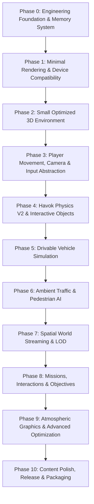

# Project Development Roadmap — Vice-City Engine

> **Document Type:** Dependency-Aware Milestone & Engineering Roadmap  
> **Status:** Authoritative Multi-Phase Plan  
> **Current Phase:** Phase 0 (Foundation & Memory System)  
> **Last Verified Date:** 2026-11-04  

---

## 1. Roadmap Architecture & Dependency Graph

Development progresses strictly through sequential technical verification gates. Downstream phases may not begin until upstream gates have satisfied their completion criteria.

---

## 2. Milestone Phase Breakdown

### Phase 0: Project Foundation & Engineering Memory
- **Status:** `[IN_PROGRESS]` (Under Active Verification in Task 001)
- **Objective:** Establish the complete architectural baseline, technical research library, project requirements, risk register, and AI operating protocol (`AGENTS.md` & `brain.md`).
- **Prerequisites:** Clean workspace, Git repository initialized.
- **Expected Deliverables:** Root documentation (`AGENTS.md`, `brain.md`, `README.md`) and complete specification suite in `/docs`.
- **Technical Risks:** Contradictory specifications or unverified technical assumptions.
- **Verification Method:** Manual and automated document audit, link integrity checks, git tracking check.
- **Completion Criteria:** All 12 core documents exist, are fully cross-referenced, and contain zero hallucinated implementation claims.

---

### Phase 1: Minimal Browser Rendering & Device Compatibility
- **Status:** `[NOT_STARTED]` (Scheduled for Task 002)
- **Objective:** Scaffold the TypeScript + Vite build toolchain, integrate Babylon.js, and establish an asynchronous dual-engine bootstrapper (`WebGPUEngine` with automatic WebGL 2 fallback).
- **Prerequisites:** Phase 0 completion.
- **Expected Deliverables:**
  - `package.json` with strict dependencies (`@babylonjs/core`, `vite`, `typescript`).
  - `tsconfig.json` with strict mode enabled.
  - `index.html` with responsive fullscreen canvas container.
  - `src/main.ts` with `EngineFactory.CreateAsync` bootstrapper.
  - Simple test cube with FPS and backend telemetry counter.
- **Technical Risks:** WebGPU permission/security flags in browsers; canvas DPI scaling artifacts on high-density displays.
- **Verification Method:** Launch dev server, test rendering in Chrome (WebGPU active) and Firefox/Safari fallback (WebGL 2 active); verify zero console errors.
- **Completion Criteria:** Stable 60 FPS rendering of test scene on reference laptop; both WebGPU and WebGL 2 backends verified.

---

### Phase 2: Small Optimized 3D Environment (Test District)
- **Status:** `[NOT_STARTED]`
- **Objective:** Construct and render a modular single-block urban prototype featuring roads, sidewalks, basic buildings, and street furniture.
- **Prerequisites:** Phase 1 completion, Babylon glTF loader registered.
- **Expected Deliverables:**
  - Modular 3D test block exported as optimized `.glb`.
  - PBR material setup with ambient and directional sunlight.
  - Frustum culling and thin instancing for street props (lamps, trees).
  - Diagnostic camera orbit for environment inspection.
- **Technical Risks:** Excessive draw calls and uncompressed texture VRAM consumption.
- **Verification Method:** Babylon Inspector metrics audit: draw calls < 80, memory < 350 MB on reference machine.
- **Completion Criteria:** City block renders seamlessly without frame hitching or memory leaks over a 10-minute session.

---

### Phase 3: Player Movement, Camera & Input Abstraction
- **Status:** `[NOT_STARTED]`
- **Objective:** Implement a responsive third-person character locomotion system with input abstraction supporting keyboard, mouse, and mobile touch.
- **Prerequisites:** Phase 2 environment in place.
- **Expected Deliverables:**
  - `InputService` normalizing Keyboard/Mouse and Touch/Virtual Joysticks.
  - Animated 3D character model with state machine (Idle, Walk, Run, Jump).
  - Third-person spring-arm camera with pitch/yaw orbit and wall-collision detection.
  - Mobile touch virtual stick HUD overlay.
- **Technical Risks:** Input latency on touch devices; camera clipping through building geometry.
- **Verification Method:** Manual movement testing across desktop and touch simulation; wall collision boundary checks.
- **Completion Criteria:** Character traverses terrain, climbs 30° slopes, stops at walls, and orbits camera smoothly without clipping.

---

### Phase 4: Havok Physics V2 & Interactive Objects
- **Status:** `[NOT_STARTED]`
- **Objective:** Integrate `@babylonjs/havok` WASM, establish scene physics, and migrate character locomotion to `PhysicsCharacterController`.
- **Prerequisites:** Phase 3 locomotion prototype.
- **Expected Deliverables:**
  - Asynchronous Havok WASM initialization pipeline.
  - Static environment collision meshes (roads, curbs, buildings).
  - Dynamic rigid-body physics for props (crates, barrels, traffic cones).
  - Collision filtering layers and physics debug visualization toggle.
- **Technical Risks:** Vite WASM bundling MIME-type errors; CPU thread overload from too many active dynamic bodies.
- **Verification Method:** Havok debug viewer; stress test dropping 50 dynamic boxes onto terrain; confirm rigid-body sleep state.
- **Completion Criteria:** Havok ticks at steady 60 Hz; physics CPU time < 3.0ms per frame on reference laptop.

---

### Phase 5: Drivable Vehicle Simulation
- **Status:** `[NOT_STARTED]`
- **Objective:** Implement a responsive, drivable 3D vehicle utilizing raycast suspension physics, steering mechanics, and enter/exit state transitions.
- **Prerequisites:** Phase 4 physics integration.
- **Expected Deliverables:**
  - Vehicle entity with chassis rigid body and 4 raycast wheel suspension springs.
  - Driving mechanics: throttle acceleration, reverse, steering, and handbrake braking.
  - Contextual vehicle enter/exit trigger system (`F` key / touch button).
  - Vehicle third-person camera mode with velocity-dependent FOV expansion.
- **Technical Risks:** Physics instability (jittering, launching into air on collision) with discrete raycasts.
- **Verification Method:** Test vehicle driving across road surfaces, taking 90° corners, hitting curbs, and smooth entry/exit transitions.
- **Completion Criteria:** Vehicle drives stably at high speed, collides with obstacles realistically, and transfers control seamlessly between foot and vehicle.

---

### Phase 6: Ambient Traffic & Pedestrian AI
- **Status:** `[NOT_STARTED]`
- **Objective:** Populate the city grid with autonomous ambient vehicles conforming to road lanes and wandering sidewalk pedestrians.
- **Prerequisites:** Phase 5 vehicle system.
- **Expected Deliverables:**
  - Road network waypoint graph with lane directions.
  - Pooled traffic vehicle spawner (max 10–12 active within 150m radius).
  - Simple forward obstacle detection raycasts for traffic braking.
  - Pedestrian wander state machine using low-poly pooled models.
- **Technical Risks:** CPU overhead from AI pathing; crowd simulation GC allocations.
- **Verification Method:** Profiler audit checking CPU frame time impact with 10 cars and 20 pedestrians active simultaneously.
- **Completion Criteria:** Total traffic/pedestrian tick < 2.0ms per frame; zero runtime GC spikes.

---

### Phase 7: Spatial World Streaming & LOD Management
- **Status:** `[NOT_STARTED]`
- **Objective:** Expand the urban environment beyond a single block into a multi-district city using 64m × 64m grid chunks with asynchronous streaming and LOD.
- **Prerequisites:** Phase 6 simulation systems.
- **Expected Deliverables:**
  - Spatial Chunk Manager tracking player position on a 2D grid.
  - Asynchronous chunk load, activate, cache, and dispose lifecycle.
  - LOD 0 (high detail) to LOD 2 (low poly / billboard impostors).
  - Distance fog masking chunk streaming boundaries.
- **Technical Risks:** Hitching/stuttering during chunk glTF loading and GPU buffer creation.
- **Verification Method:** Drive at top vehicle speed across 6 city blocks; monitor frame time variance and memory growth.
- **Completion Criteria:** Memory usage stays below 900 MB across continuous traversal; frame drops remain under 16ms.

---

### Phase 8: Missions, Interactions & Game Objectives
- **Status:** `[NOT_STARTED]`
- **Objective:** Build an event-driven mission system with checkpoints, delivery runs, interactive NPCs, and narrative objectives.
- **Prerequisites:** Phase 7 world streaming.
- **Expected Deliverables:**
  - Mission state graph (Start, Checkpoints, Fail, Complete).
  - Spatial checkpoint triggers with visual 3D rings and HUD waypoints.
  - Mini-map rendering objective icons and route compass.
  - Interactive dialogue / mission accept prompts.
- **Technical Risks:** Complex state synchronization across streaming chunk boundaries.
- **Verification Method:** Complete a full 3-checkpoint timed vehicle mission; verify restart on failure.
- **Completion Criteria:** 3 distinct test missions playable from start to finish with accurate HUD tracking and rewards.

---

### Phase 9: Atmospheric Graphics & Advanced Optimization
- **Status:** `[NOT_STARTED]`
- **Objective:** Polish visual immersion through dynamic day/night cycles, PBR materials, KTX2 texture transcoding, and post-processing.
- **Prerequisites:** Phase 8 gameplay systems.
- **Expected Deliverables:**
  - Rotating sun/moon directional light with atmospheric color shifts.
  - Streetlamps, neon building signs, and vehicle headlights at night.
  - KTX2 / Basis Universal compressed textures in production builds.
  - Meshopt geometry compression via `EXT_meshopt_compression`.
  - Cascaded shadow maps with distance falloff.
- **Technical Risks:** Performance degradation on integrated Intel GPU from high fill-rate lighting.
- **Verification Method:** Benchmark FPS in day and night modes; verify texture VRAM reduction via KTX2.
- **Completion Criteria:** Stable 60 FPS maintained in night scene on reference laptop; initial bundle < 25 MB.

---

### Phase 10: Content Polish, Release Packaging & Distribution
- **Status:** `[NOT_STARTED]`
- **Objective:** Package the engine and vertical slice for public web deployment with cross-device audio, persistence, and automated CI.
- **Prerequisites:** Phase 9 graphical optimization.
- **Expected Deliverables:**
  - Complete Web Audio implementation (engine audio, ambient city noise, original music).
  - IndexedDB save/load system for progress persistence.
  - Mobile touch polish and full-screen PWA support.
  - GitHub Actions CI pipeline running typecheck, build, and automated tests.
  - Production deployment to static web hosting (e.g., Cloudflare Pages / Vercel).
- **Technical Risks:** Audio autoplay blocking on mobile Safari; storage quota restrictions.
- **Verification Method:** Clean run on live URL across desktop (Windows, Mac, Linux) and mobile (iPhone, Android).
- **Completion Criteria:** Publicly accessible URL loading under 5 seconds with zero external dependencies.
