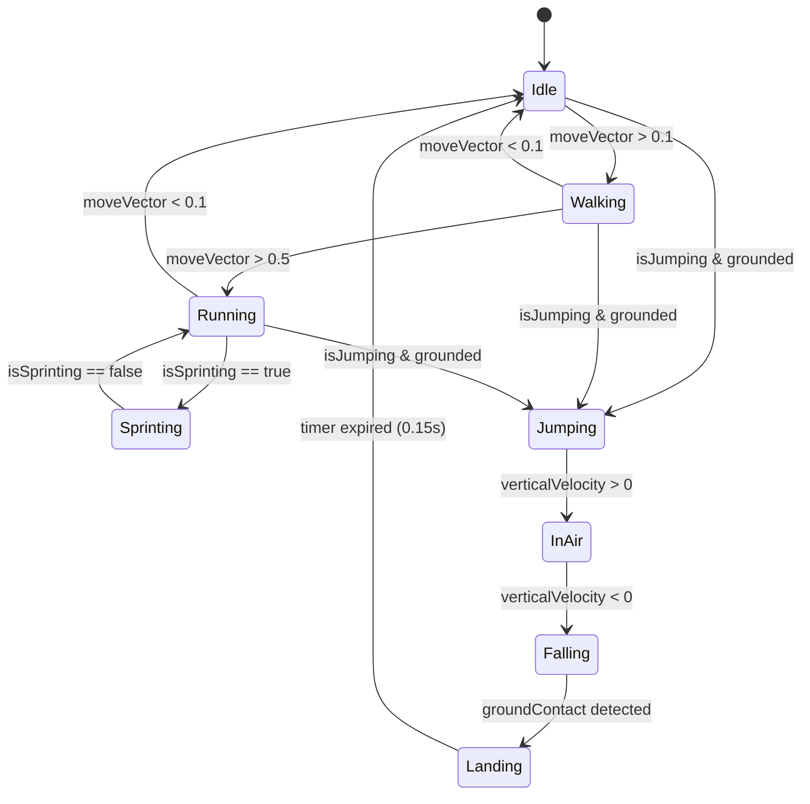
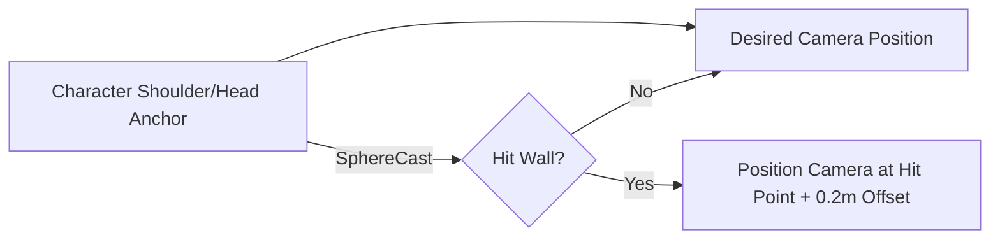
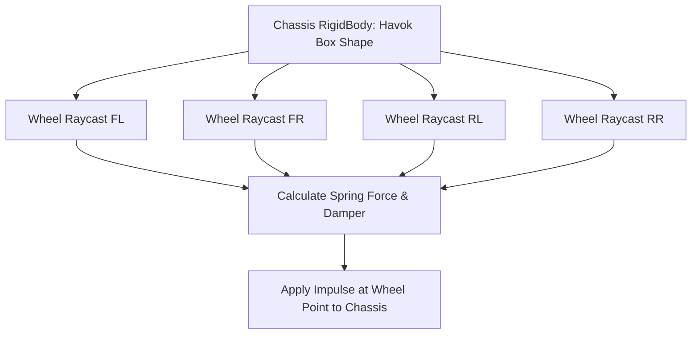
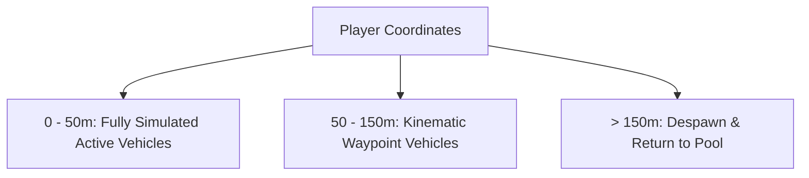
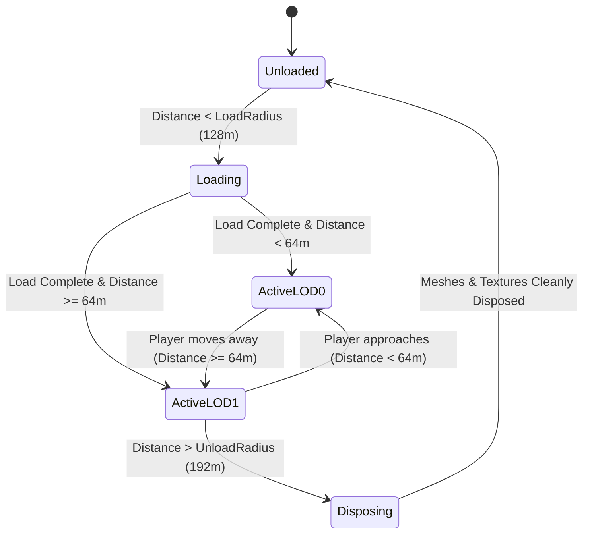

# System Design Specifications — Vice-City Game Systems

> **Document Type:** Detailed System Design  
> **Status:** `[PROPOSED]` / Authoritative Engineering Specifications  
> **Target Subsystems:** Locomotion, Vehicles, Traffic, NPC AI, Camera, Streaming, Audio, UI  
> **Last Verified Date:** 2026-11-04  

---

## 1. Locomotion & Character Controller System (`SYS-LOC`)

### 1.1 Responsibility
Manages player locomotion, state transitions (idle, walk, run, sprint, jump, fall, land), collision response against 3D urban terrain, and animation blend weights.

### 1.2 System Interfaces & Data Flow
- **Inputs:** `InputService.moveVector`, `InputService.isSprinting`, `InputService.isJumping`, camera forward/right vectors, delta time.
- **Outputs:** Character world position, orientation quaternion, active animation state, ground contact state.
- **Dependencies:** Babylon.js Core, Havok Physics V2 (`PhysicsCharacterController` or kinematic capsule).

### 1.3 Architectural Design


### 1.4 Implementation Approach
- Use Babylon.js Physics V2 `PhysicsCharacterController` capsule (height: 1.8m, radius: 0.4m).
- Perform `checkSupport()` each frame to test ground normal and ground velocity.
- Use `calculateMovement()` with target speeds:
  - Walk: 2.5 m/s
  - Run: 5.5 m/s
  - Sprint: 8.5 m/s
- Integrate gravity (`-9.81 m/s²`) when unsupported.
- Rotate visual mesh smoothly toward desired movement vector using `Quaternion.Slerp` with an angular speed of 12 rad/s.

### 1.5 Performance Concerns & Mitigations
- Continuous ground raycasting can cost CPU cycles; clamp ground checks to 60 Hz physics ticks.
- Reuse static scratch vectors for velocity and direction calculation to prevent GC allocations.

### 1.6 Verification & Testing
- Automated test: Character ascends 30° ramp without sliding or jittering.
- Automated test: Character cannot penetrate solid vertical static meshes.
- Manual test: Step-up over 0.25m curbs works seamlessly without jumping.

---

## 2. Camera System (`SYS-CAM`)

### 2.1 Responsibility
Maintains third-person follow perspective behind the player character or vehicle, executes spherical orbit look rotations from mouse/touch, and prevents the camera from clipping into walls.

### 2.2 System Interfaces & Data Flow
- **Inputs:** `InputService.lookVector`, player/vehicle transform, scene collision raycasts.
- **Outputs:** Camera position, target position, field of view (FOV).
- **Dependencies:** Babylon.js `TargetCamera` or `UniversalCamera`, scene collision spatial tree.

### 2.3 Spring-Arm Collision Avoidance


### 2.4 Modes & Parameters
- **On-Foot Mode:** Default distance 3.2m, shoulder offset +0.4m right, FOV 65°.
- **Vehicle Driving Mode:** Default distance 6.5m, pitch fixed at +15°, FOV 65°–80° dynamically scaling with vehicle velocity.
- **Collision Cushion:** 0.15m sphere-cast radius prevents frustum near-plane polygon clipping.

### 2.5 Performance Concerns & Mitigations
- Limit sphere-cast queries to 1 per frame; filter collision masks strictly to static geometry (`0x0001`).

---

## 3. Vehicle Simulation & Physics System (`SYS-VEH`)

### 3.1 Responsibility
Simulates motor vehicle dynamics: motor torque, wheel steering, braking, weight transfer, raycast suspension spring/dampers, and tire friction.

### 3.2 Implementation Approach: Raycast Suspension vs 6DoF Rig
> **Architectural Decision:** We prioritize a **Raycast Suspension Model** over a 4-wheel rigid body constraint rig.



### 3.3 Physics Formulas:
- **Suspension Spring Force:** $F_s = K \cdot (L_{rest} - L_{current}) - D \cdot V_{suspension}$
  - $K$: Spring stiffness (e.g., 25,000 N/m)
  - $D$: Damping factor (e.g., 2,500 Ns/m)
- **Tire Lateral Friction:** Longitudinal force accelerates vehicle; lateral force dampens sideways sliding with a slip curve.

### 3.4 Vehicle Entry / Exit Lifecycle
1. **Approach Zone:** When player is within 2.5m of driver door, HUD shows prompt `"Press [F] or Tap to Drive"`.
2. **Transition:** Player disables character capsule, attaches mesh as hidden or seated in vehicle cabin, and camera shifts to vehicle rig.
3. **Exit:** Vehicle checks left side clearance with raycast; if clear, unseats character at +1.2m lateral offset and reactivates character controller.

### 3.5 Performance Concerns & Mitigations
- Full 4-wheel rigid body joints with Havok are computationally expensive for 2-core CPUs. Raycast suspension uses only 4 down-ray queries per vehicle, scaling easily to 10+ vehicles at 60 FPS.

---

## 4. Traffic & Pedestrian Simulation (`SYS-TRF`)

### 4.1 Responsibility
Populates urban streets with ambient vehicular traffic and sidewalk pedestrians to create a living city atmosphere without exceeding the CPU and memory budget.

### 4.2 Architectural Design: Distance-Based Pooling


### 4.3 Node-Based Navigation
- City streets contain pre-baked waypoint splines (`RoadNode`).
- Each node stores: `position: Vector3`, `nextNodes: RoadNode[]`, `speedLimit: number`.
- Ambient vehicles advance along waypoints using simple kinematic translation (`position += velocity * dt`), checking a forward ray (10m) for obstruction. If obstructed, vehicle applies brakes.

### 4.4 Pedestrian Crowds
- Pedestrians use Babylon.js `Thin Instances` or low-poly shared meshes.
- Wandering behavior is driven by a simple finite state machine: `Wander -> Wait at Crossing -> Cross Street -> Wander`.

### 4.5 Performance & Memory Budget
- Max concurrent active traffic vehicles: **12**.
- Max concurrent active pedestrians: **20**.
- Total CPU time budget for traffic & pedestrian tick: **< 1.5ms per frame**.

---

## 5. Interaction System (`SYS-INT`)

### 5.1 Responsibility
Detects player proximity to interactive entities (vehicles, mission markers, doors, props), presents contextual HUD prompts, and routes activation commands.

### 5.2 System Interfaces
```typescript
export interface IInteractable {
    readonly interactionId: string;
    readonly promptText: string;
    readonly interactionRadius: number;
    canInteract(player: PlayerEntity): boolean;
    onInteract(player: PlayerEntity): void;
}
```

### 5.3 Flow
- Player maintains a trigger zone query (checked at 10 Hz rather than 60 Hz).
- Nearest valid interactable emits an event to the `UIOverlayService` to render a floating or screen prompt.
- Pressing `F` or tapping the screen button calls `onInteract()`.

---

## 6. Mission & Objective System (`SYS-MIS`)

### 6.1 Responsibility
Coordinates narrative progression, checkpoint triggers, timed challenges, delivery runs, and exploration rewards.

### 6.2 Implementation Architecture
- **State Graph:** Missions are configured as declarative JSON/TypeScript state nodes:
  - `Objective`: e.g., "Drive to the Industrial Harbor", "Reach the rooftop in under 60 seconds".
  - `Triggers`: Spatial cylinder trigger checks player or vehicle overlap.
  - `Outcomes`: Success rewards, failure restart points.
- Status: `[PROPOSED]` (Speculative for Phase 8; design validated, implementation deferred).

---

## 7. World Streaming & Spatial Chunk Manager (`SYS-WRD`)

### 7.1 Responsibility
Partitions the open-world map into modular spatial chunks (64m × 64m), loading geometry, collision, and props asynchronously based on player position, and unloading distant chunks to maintain a strict memory ceiling.

### 7.2 Chunk Lifecycle


### 7.3 Memory Conservation
- Never keep more than 9 active chunks loaded simultaneously.
- When disposing a chunk, invoke `mesh.dispose(false, true)` to purge index buffers, vertex buffers, and unshared materials from GPU memory.

---

## 8. Environmental, Lighting & Day-Night System (`SYS-ENV`)

### 8.1 Responsibility
Drives atmospheric immersion: procedural skybox, directional sunlight rotation, ambient color grading, streetlights activation, and fog density.

### 8.2 Lighting Topology
- **Primary Directional Light:** Simulates the Sun and Moon. Rotates 360° over a configurable day length (e.g., 20 minutes real-time).
- **Cascaded Shadow Map (CSM):** Active only on desktop high-performance tier; disabled or clamped to 1 cascade on mobile.
- **Hemispheric Ambient Light:** Soft sky/ground ambient fill with colors shifting from warm sunrise amber to midday blue to deep indigo night.
- **Fog:** Linear exponential fog (`scene.fogMode = Scene.FOGMODE_EXP2`) hiding chunk streaming boundaries at distances beyond 200m.

---

## 9. Save & Persistence System (`SYS-SAV`)

### 9.1 Responsibility
Persists user game progress, unlocked vehicles, player coordinates, and configuration settings across browser refreshes without server dependencies.

### 9.2 Storage Backend
- **IndexedDB via simple KV wrapper / LocalStorage:**
  - `vice_city_settings`: Audio volumes, graphics quality tier, keybindings.
  - `vice_city_savegame`: Player position, vehicle stats, completed mission IDs, timestamp.
- JSON serialization with schema versioning (`version: 1`) to facilitate forward migration.

---

## 10. User Interface & Touch Controls System (`SYS-UI`)

### 10.1 Responsibility
Provides clean, high-performance visual feedback: HUD, speedometer, mini-map, dialogue/objective prompts, and responsive mobile virtual joysticks.

### 10.2 Architectural Boundary
- Built as a decoupled DOM/HTML5 overlay layered cleanly above `<canvas id="gameCanvas">`.
- Minimizes Babylon.js GUI redraw overhead; standard HTML/CSS hardware-accelerated transforms (`transform: translate3d`) execute on browser compositor threads without taxing the WebGPU render loop.
- **Mobile Virtual Stick:** Custom touch listener capturing pointer down/move/up events, calculating normalized circular clamp $(-1.0 \text{ to } +1.0)$.

---

## 11. Audio Architecture (`SYS-AUD`)

### 11.1 Responsibility
Provides spatial 3D audio for environmental effects, vehicle engine acceleration pitch modulation, tire screeches, ambient city rumble, and radio playback.

### 11.2 Subsystem Design
- Built on standard HTML5 Web Audio API and Babylon.js `AudioEngine`.
- **Sound Groups:** Master (1.0), SFX (0.8), Engine (0.7), Music/Radio (0.6).
- **Engine Sound Synthesis / Pitch Modulation:** Uses a looping engine sample modulated via `sound.setPlaybackRate(0.8 + currentSpeed / maxSpeed * 1.4)`.
- **User Gesture Unlock:** Web Audio context requires an initial user click/touch to unlock; bound to the start screen.
