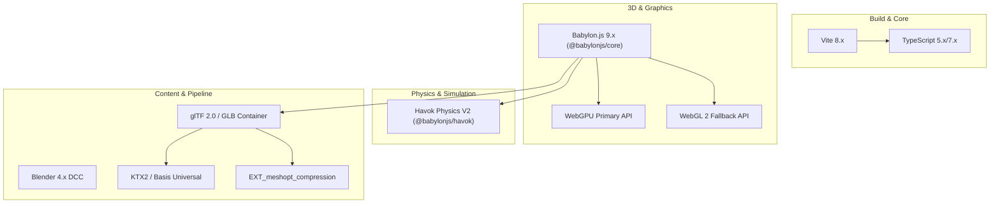

# Technology Stack Reference — Vice-City Engine

> **Document Type:** Technical Stack Specification & Evaluation  
> **Status:** `[VERIFIED]` / Project Standard Baseline  
> **Architecture Level:** Non-Negotiable Core Stack  
> **Last Verified Date:** 2026-11-04  

---

## 1. Stack Overview & Classification

The technology stack is divided strictly into **Confirmed Core Technologies** (approved and mandated) and **Optional Candidate Libraries** (under evaluation).

---

## 2. Confirmed Core Technologies

### 2.1 TypeScript
- **Purpose:** Primary application programming language.
- **Selection Rationale:** Static type verification, zero-overhead compile step, comprehensive IDE autocompletion, refactoring safety for complex 3D math and physics systems.
- **Key Capabilities:** Strict null checking, discriminated unions, generic constraints, ES module output.
- **Limitations:** Compiles down to JavaScript; no runtime performance advantages over raw hand-optimized JS.
- **Browser Compatibility:** Transpiled to ES2022+ targeting all modern browsers.
- **License:** Apache License 2.0.
- **Official Documentation:** [typescriptlang.org](https://www.typescriptlang.org/)
- **Proposed Version:** `^5.8.0` / `^7.0.0` (Exact target: modern stable).
- **Installed Status:** Not yet installed (`package.json` initialization scheduled for Phase 1).
- **Known Integration Risks:** Heavy typings in `@babylonjs/core` can increase compile times if not configured with `skipLibCheck: true`.

---

### 2.2 Babylon.js (`@babylonjs/core`, `@babylonjs/loaders`)
- **Purpose:** Complete 3D web rendering engine, scene graph, asset loading, and physics plugin abstraction.
- **Selection Rationale:** Industry-standard 3D web engine with first-class native WebGPU support, built-in Havok physics plugin, complete glTF 2.0 loader ecosystem, active Microsoft backing, and zero external runtime dependencies.
- **Key Capabilities:**
  - `EngineFactory.CreateAsync` for automatic WebGPU/WebGL 2 selection.
  - Granular ES6 module packaging enabling strict tree-shaking.
  - Thin instancing and hardware mesh instancing.
  - Dynamic cascaded shadow maps (CSM) and PBR materials.
  - Built-in `PhysicsCharacterController` and Physics V2 architecture.
- **Limitations:** Larger footprint than minimalist libraries (e.g., Three.js) if entire monolithic bundle is imported. Requires disciplined modular imports (`@babylonjs/core/...`).
- **Browser Compatibility:** All WebGPU and WebGL 2 capable browsers on Windows, macOS, Linux, Android, and iOS.
- **License:** Apache License 2.0.
- **Official Documentation:** [doc.babylonjs.com](https://doc.babylonjs.com/)
- **Proposed Version:** `^9.32.0` (Modular ES6 packages).
- **Installed Status:** Not yet installed (scheduled for Phase 1).
- **Known Integration Risks:** WebGPU compute pipeline shader compilation stutters on first render if materials are not pre-warmed.

---

### 2.3 Vite
- **Purpose:** Development server, build bundler, and asset management toolchain.
- **Selection Rationale:** Near-instant hot module replacement (HMR), native ES module support in development, highly optimized Rollup-based production builds, minimal configuration overhead compared to Webpack.
- **Key Capabilities:** Built-in static asset handling, WebAssembly import support, fast production minification via esbuild/Rollup.
- **Limitations:** Requires specific plugin configuration (`vite-plugin-wasm` or static asset serving) for `@babylonjs/havok` WASM binary.
- **Browser Compatibility:** Development requires modern browser with native ESM; production outputs standard browser bundles.
- **License:** MIT License.
- **Official Documentation:** [vite.dev](https://vite.dev/)
- **Proposed Version:** `^8.3.0` / `^6.x`.
- **Installed Status:** Not yet installed (scheduled for Phase 1).
- **Known Integration Risks:** Large WASM assets must be excluded from inlining or served with proper `application/wasm` MIME type.

---

### 2.4 WebGPU (Primary Rendering Backend)
- **Purpose:** Next-generation browser graphics and compute pipeline.
- **Selection Rationale:** Direct low-level access to modern GPU hardware, drastically lower CPU driver overhead compared to WebGL, compute shader capabilities, predictable multi-draw operations.
- **Key Capabilities:** Native bind groups, render bundles, compute shaders, modern shader language (WGSL).
- **Limitations:** Not yet supported on 100% of legacy or budget mobile devices; requires asynchronous engine initialization.
- **Browser Compatibility:** Chrome/Edge (Windows/macOS/ChromeOS 113+), Safari (iOS/macOS 16.4+), Firefox (Windows 141+ stable, macOS/Linux expanding).
- **Specification:** [W3C WebGPU Candidate Recommendation](https://www.w3.org/TR/webgpu/)
- **License:** Open W3C / Khronos Standard.
- **Proposed Version:** W3C Standard.
- **Installed Status:** Browser-native API.
- **Known Integration Risks:** GPU device loss (`device.lost`) must be caught to prevent permanent render freeze.

---

### 2.5 WebGL 2 (Fallback Rendering Backend)
- **Purpose:** Guaranteed rendering compatibility fallback when WebGPU is unavailable or disabled.
- **Selection Rationale:** Ubiquitously supported across 99%+ of all active desktop and mobile web browsers.
- **Key Capabilities:** 3D textures, uniform buffer objects, transform feedback, instanced rendering.
- **Limitations:** High CPU driver overhead, synchronous shader compilation bottlenecks, no compute shader support.
- **Browser Compatibility:** 99%+ global support across all desktop and mobile browsers.
- **Specification:** [Khronos WebGL 2.0 Specification](https://www.khronos.org/registry/webgl/specs/latest/2.0/)
- **License:** Open Khronos Standard.
- **Proposed Version:** WebGL 2.0.
- **Installed Status:** Browser-native API.
- **Known Integration Risks:** Higher draw-call sensitivity on integrated GPUs like Intel UHD Graphics G1.

---

### 2.6 Havok Physics V2 (`@babylonjs/havok`)
- **Purpose:** Core physics engine: rigid-body dynamics, vehicle suspension forces, character controller movement, collision detection.
- **Selection Rationale:** Industry-standard AAA physics solver compiled to high-speed WebAssembly; fully integrated with Babylon.js Physics V2 architecture (`HavokPlugin`); delivered under a permissive free-to-use MIT license.
- **Key Capabilities:** Sub-step determinism, continuous collision detection (CCD), specialized `PhysicsCharacterController`, compound shapes, raycast vehicle queries, 6DoF constraints.
- **Limitations:** Runs on WebAssembly (CPU thread); complex multi-body piles will stress 2-core laptop CPUs if not sleep-optimized.
- **Browser Compatibility:** All browsers supporting WebAssembly (WASM).
- **License:** **MIT License** (verified from `@babylonjs/havok` npm package and GitHub repository `BabylonJS/havok`).
- **Official Documentation:** [doc.babylonjs.com/features/featuresDeepDive/physics/havokPlugin](https://doc.babylonjs.com/)
- **Proposed Version:** `^1.3.0` / companion version for Babylon 8.x/9.x.
- **Installed Status:** Not yet installed (scheduled for Phase 1).
- **Known Integration Risks:** Must ensure `HavokPhysics()` async initialization resolves before enabling physics on the scene.

---

### 2.7 Blender 4.x
- **Purpose:** Digital content creation (DCC) for 3D environment blocks, vehicle meshes, character modeling, and animation rigging.
- **Selection Rationale:** Industry-standard, fully open-source 3D production suite with native, robust Khronos glTF 2.0 export capabilities.
- **License:** GNU General Public License (GPL v3+). (Note: Art assets exported from Blender are owned 100% by the creator and are NOT subject to GPL).
- **Official Documentation:** [blender.org](https://www.blender.org/)
- **Proposed Version:** Blender 4.2 LTS / 4.3+.

---

### 2.8 glTF 2.0 / GLB Format with KTX2 & Meshopt
- **Purpose:** Runtime 3D asset delivery container.
- **Selection Rationale:** "The JPEG of 3D"; native web format supported directly by Babylon.js with zero runtime conversion needed.
- **Key Extensions:**
  - `KHR_texture_basisu`: GPU-compressed KTX2 textures (ETC1S/UASTC) decoded directly to GPU VRAM formats (BC7, ASTC, ETC2).
  - `EXT_meshopt_compression`: High-ratio geometry compression for vertex/index buffers.
- **License:** Open Khronos Standard.
- **Official Specification:** [Khronos glTF 2.0 Specification](https://www.khronos.org/gltf/)

---

## 3. Optional & Candidate Libraries (Evaluation Matrix)

| Candidate Library | Purpose | License | Pros | Cons / Risks | Status |
|---|---|---|---|---|---|
| `@babylonjs/gui` | 2D / 3D In-Scene UI | Apache 2.0 | Integrated into scene graph, supports billboard 3D tags. | Adds bundle weight; redraws trigger GPU uploads. | `[PROPOSED]` Evaluate vs HTML/CSS DOM HUD in Phase 1. |
| `gl-matrix` | Standalone SIMD Math | MIT | Extremely fast raw array math. | Redundant with Babylon's optimized `Vector3` and `Matrix`. | `[DEPRECATED]` Do not add; use Babylon math. |
| `cannon.js` / `ammo.js` | Legacy Physics | MIT / zlib | Pure JS or older Bullet port. | Replaced by Havok V2; far worse performance. | `[DEPRECATED]` Forbidden in this project. |
| `gltf-validator` | Asset CI Validation | Apache 2.0 | Validates glTF compliance in build pipelines. | CLI tool, not bundled in runtime client. | `[PROPOSED]` Recommended for asset validation. |
